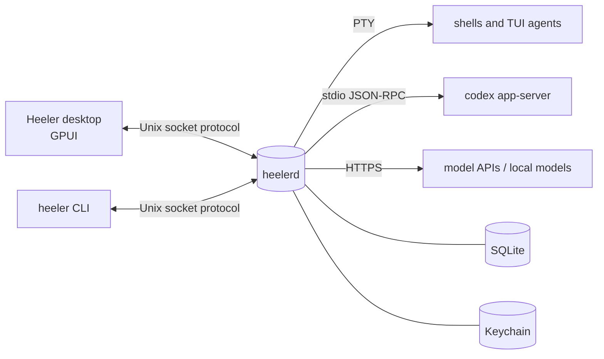

# Heeler

**A native macOS agentic development environment in Rust.** A real terminal emulator and an AI-agent workspace in one GPUI app. It runs on a separate daemon (`heelerd`) that keeps your shells, coding agents and chats alive when the window is closed.

> **Status: pre-alpha, macOS only, not released.** The first vertical slice (milestones M0–M6) is nearly complete. Native notifications and launch-at-login (M6-B) are still open, and several UI surfaces have not had a visual review yet. Expect breaking protocol changes. See [`docs/status.md`](docs/status.md) and [`docs/roadmap.md`](docs/roadmap.md).

## Why

- **The daemon is the source of truth.** If the UI crashes or you close it, work keeps going. The desktop app, the `heeler` CLI and any future remote client all speak the same protocol over a Unix socket.
- **Terminal-first.** Shells and TUI agents (Claude Code, Codex, OMP, OpenCode) run unmodified in a real PTY. Structured agent chat is added on top of terminals, not instead of them.
- **Native and light.** No Electron and no webview for the core UI, and performance budgets are measured (`just bench`).
- **Permissions are enforced in the daemon.** UI dialogs only collect decisions, and API keys live in the macOS Keychain.

## What works today

| Area | What you get |
|---|---|
| Terminals | PTY sessions owned by the daemon, compact bounded scrollback, detach/reattach, several clients attached at once, restore after a daemon restart (respawned in the last cwd) |
| Shell blocks | zsh/bash/fish integration injected automatically (OSC 133/7): commands become blocks with exit code and duration that you can jump to, copy, collapse or send to an agent |
| Workbench | GPUI desktop with docks, split panes, zoom, presets (default/focus/overview), ⌘K palette, settings in TOML with hot reload, keymap file |
| Workspaces | One workspace per project, plus a permanent **Home**; ⌘O to open, ⌘J to jump; sort modes, pins and per-workspace layouts |
| Agent chat | Codex through `codex app-server`: streaming, tool cards, diffs, plans, approvals enforced in the daemon; the same conversation is visible from the CLI |
| Agent monitor | Live state (working/blocked/idle) of agents and subagents from Codex, Claude Code hooks and the OMP extension |
| Direct model chat | OpenAI-compatible, Anthropic and Ollama/LM Studio providers; switch models mid-conversation; keys in Keychain |
| Assistant | ⌥Space opens a quick chat, global or per workspace; context (shell output, agent transcript, file, search) is attached explicitly as chips, then redacted and bounded |
| History search | Opt-in local SQLite FTS5 index over Heeler sessions and Claude Code, Codex and OMP transcripts, with one-click **Resume** |
| Notifications (API) | The daemon raises intents (approval needed, agent blocked/finished, non-zero exit, reply ready); `heeler notify watch` prints them. Native macOS delivery is M6-B |
| App bundle | `just bundle` builds an ad-hoc signed `Heeler.app` (desktop, daemon, CLI) |

## Architecture



Crates live in `crates/` (`core`, `protocol`, `daemon`, `client`, `cli`, `terminal`, `terminal_view`, `desktop`, `agents`, `gateway`, `storage`, `index`, `settings`, `chat_view`). Details are in [`docs/architecture.md`](docs/architecture.md), and the decisions behind them in [`docs/adr/`](docs/adr).

## Requirements

- macOS 13 or later; developed on Apple Silicon.
- [rustup](https://rustup.rs). The toolchain (Rust 1.98.0) is pinned in `rust-toolchain.toml` and installs itself on the first build.
- Xcode or the Command Line Tools (`xcode-select --install`). The separate Metal toolchain is **not** needed because GPUI is built with `runtime_shaders`.
- For the quality gate: `brew install just cargo-nextest cargo-deny`.
- Optional:
  - `codex` ≥ 0.160 for Codex agent chat;
  - [Ollama](https://ollama.com) or LM Studio for local models;
  - an API key for OpenAI-compatible or Anthropic providers.

## Quick start

The first build fetches and compiles GPUI, which takes a few minutes.

```sh
git clone https://github.com/robertt3kuk/heeler.git
cd heeler
cargo build --workspace --bins --locked
```

Keep experiments away from your real data: `HEELER_HOME` puts the socket, database, logs and the Home folder into one directory.

```sh
export HEELER_HOME="$(mktemp -d)"
```

### Desktop app

```sh
cargo run -p heeler-desktop
```

The app starts `heelerd` itself, using the copy built next to it. On quit it stops the daemon if no session is running; otherwise it asks.

| Keys | Action |
|---|---|
| ⌘T / ⌘⇧T / ⌘⌥T | New terminal / new agent chat / new model chat |
| ⌥Space | Assistant |
| ⌘K | Command palette |
| ⌘D / ⌘⇧D | Split right / down |
| ⌘O / ⌘J | Open project / jump to a workspace or session |
| ⌘⇧O | Overview of all sessions |
| ⌘B / ⌘⌥B / ⌘⌥J | Toggle left / right / bottom dock |
| ⌘⇧J | Jump to the next session that needs you |
| ⌘, | Settings |

### CLI

```sh
alias heeler="$PWD/target/debug/heeler"

heeler daemon start
heeler new --title demo -- /bin/sh -c 'echo hello; exec $SHELL'
heeler ls
heeler attach demo           # detach with ctrl+\ then d
heeler history demo          # scrollback as plain text
heeler ws ls                 # workspaces (Home is always there)
heeler notify watch          # notification intents as they happen
heeler daemon stop --stop-sessions
```

Other useful commands (each takes `--help`, and every command takes `--json`):

```sh
heeler provider discover                      # find local Ollama / LM Studio
heeler provider add ollama --name Local       # provider id is made from the name
heeler chat new --direct --provider local     # chat with a model
heeler ask "what does this error mean?" --attach file:src/main.rs   # needs [assistant] provider = "local" in daemon.toml
heeler chat new                               # Codex agent chat (needs codex >= 0.160)
heeler approvals && heeler approve <id> accept
heeler index enable && heeler search "cargo test -p daemon"
heeler integration status claude              # agent hooks; install only when you want them
```

### App bundle

```sh
just bundle                  # target/bundle/Heeler.app, ad-hoc signed
just bundle --release
```

Running the bundle is safe to try. Registering it as a launch agent and native notifications are not implemented yet (M6-B).

## Development

```sh
just check     # fmt + clippy -D warnings + nextest (about 1360 tests) + cargo-deny; must be green before a merge
just bench     # performance budgets B1–B6 (docs/perf.md)
just fmt
```

- Process and conventions: [`AGENTS.md`](AGENTS.md), [`docs/process.md`](docs/process.md)
- Wire protocol: [`docs/protocol.md`](docs/protocol.md)
- UI design: [`docs/design.md`](docs/design.md)
- Vision and target scope: [`docs/vision.md`](docs/vision.md)

## Where data lives

| | Default | With `HEELER_HOME` |
|---|---|---|
| Socket, database (`heeler.db`), daemon settings (`daemon.toml`) | `~/Library/Application Support/Heeler` | `$HEELER_HOME` |
| Logs | `~/Library/Logs/Heeler` | `$HEELER_HOME/logs` |
| Home workspace folder | `~/Heeler` | `$HEELER_HOME/Heeler` |
| API keys | macOS Keychain, service `dev.heeler.provider` | same |

## License

Not decided yet. It depends on whether the embedded editor (M11) reuses GPL-3.0 crates from Zed ([ADR 0012](docs/adr/0012-embedded-editor.md)). Until a license is added, all rights are reserved.
