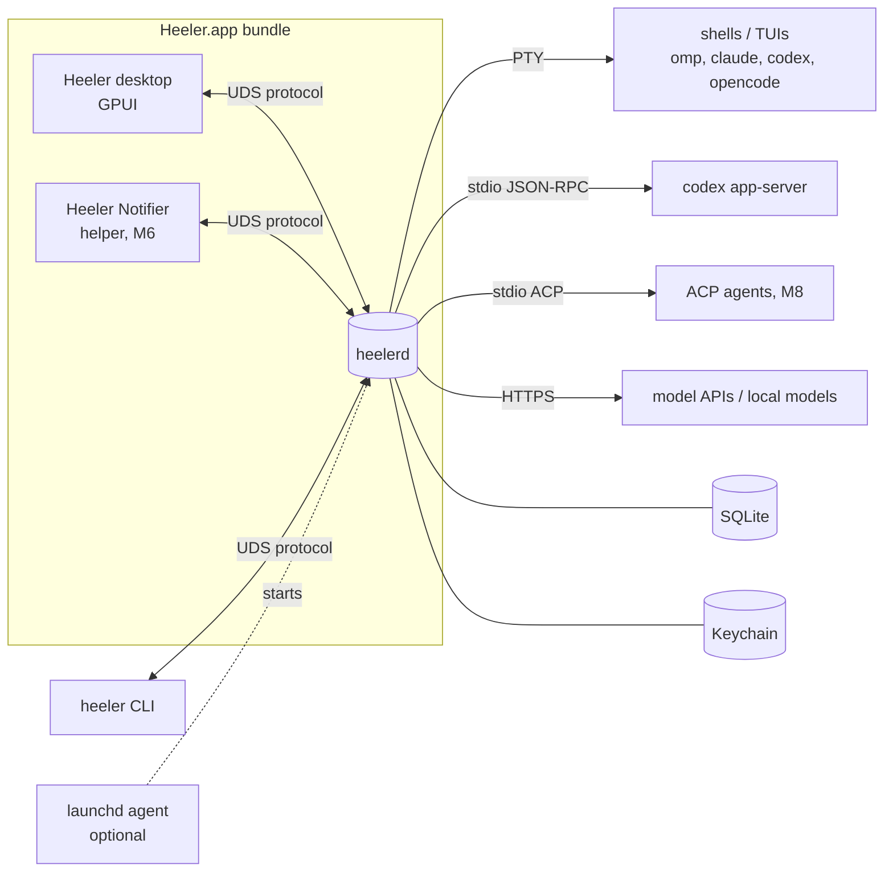
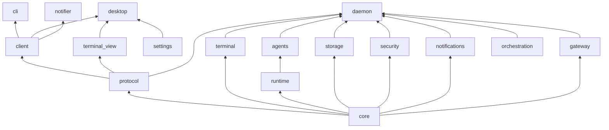
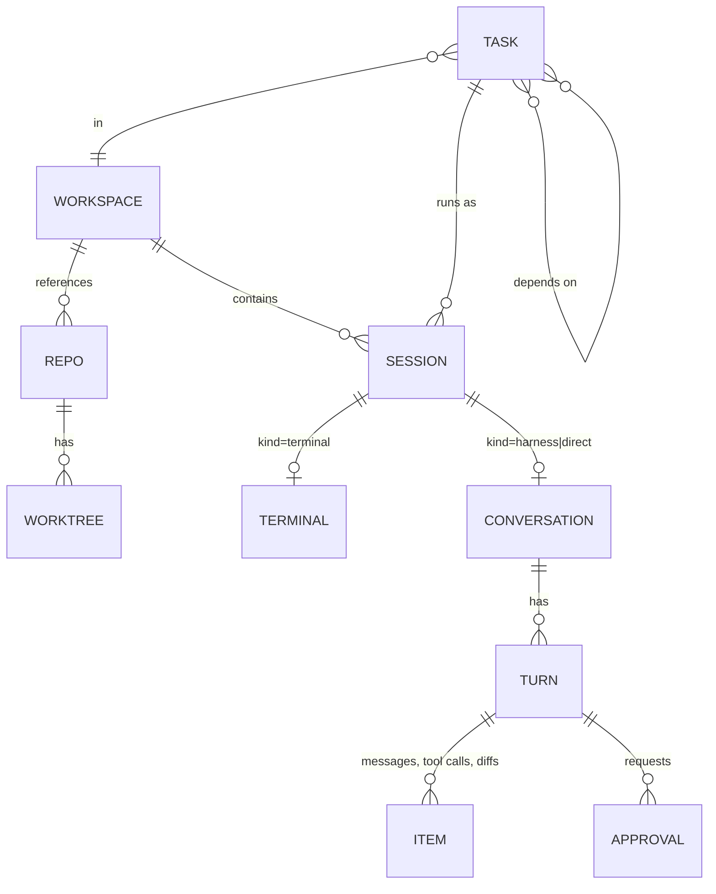
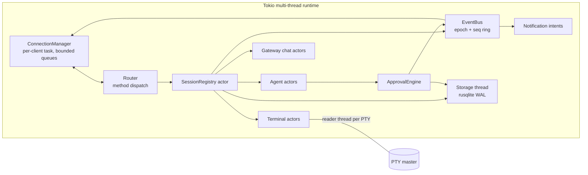
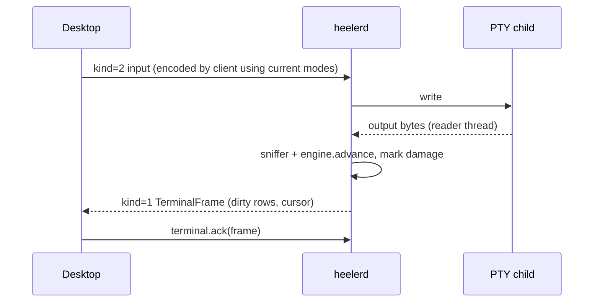
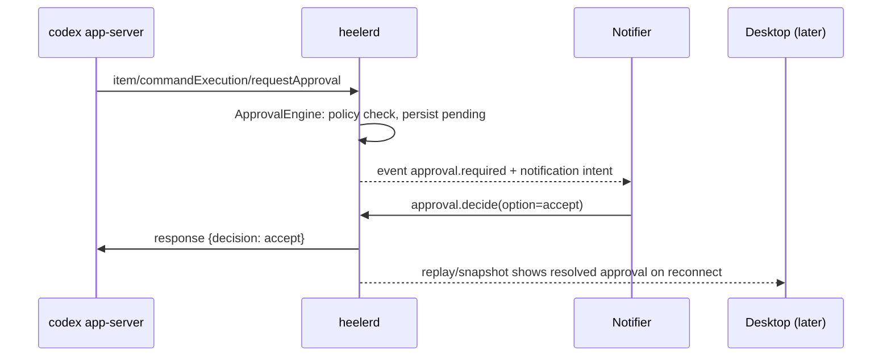

# Architecture

Rule: **daemon = execution, persistence, orchestration, security; clients = visualization and interaction; protocol = the only boundary.** Decisions behind this document live in `docs/adr/`.

## Process topology (ADR 0001, 0007)



- `heelerd` is started on demand by any client (spawn, wait for socket) or by launchd when "keep running" is enabled.
- All clients are equal protocol peers; the desktop has no private channel.

## Crates

Crates are created when their first milestone starts (no empty placeholders); package names are `heeler-<dir>`. Present now: `core`, `protocol`, `daemon` (`heelerd` + lib), `client`, `terminal`.

```text
crates/
  core/           domain types: IDs, Session/Workspace/Task models, AgentEvent, state machines (no I/O)
  protocol/       frames, envelope, handshake, commands/queries/events, render DTOs, JSON Schema gen
  client/         async protocol client: connect/spawn daemon, reconnect, replay/snapshot reconciliation
  daemon/         heelerd binary: lifecycle, connections, event bus, wiring of services below
  terminal/       PTY spawn (portable-pty), alacritty_terminal engine, OSC sniffer, render snapshot/frames
  runtime/        stdio subprocess supervision for agent adapters (spawn, restart policy, stderr capture)
  agents/         AgentAdapter trait; codex app-server adapter (M4), ACP v1 adapter (M8)
  gateway/        direct model chat: provider trait, OpenAI-compatible, Anthropic, local endpoints (M5)
  orchestration/  tasks, dependencies, worktrees, scheduling of parallel agents (M7)
  storage/        SQLite actor, migrations, repositories
  security/       Keychain, permission policy evaluation, redaction
  notifications/  notification intents from domain events (daemon side)
  cli/            heeler binary
  settings/       layered TOML settings store, schema registry, watcher, keymap (no GPUI; ADR 0010)
  terminal_view/  GPUI terminal element/view over render DTOs, input encoding (UI crate)
  desktop/        Heeler GPUI app: workbench (docks, pane tree, panels, presets), wiring (UI crate)
  notifier/       macOS notification helper (M6)
xtask/            bundle, sign, schema export, corpus recording
```



Arrows point from dependency to dependent. Forbidden: anything depending on `daemon`; UI crates or `cli` depending on service crates; GPUI in any non-UI crate (UI crates: `desktop`, `terminal_view`, later `chat_view`, `notifier`).

## Domain model



- **Session kinds**: `terminal` (PTY), `harness` (structured agent over Codex app-server/ACP), `direct` (gateway chat). One lifecycle: `starting → running → (waiting_approval) → idle | exited(code) | failed(reason) | stopped`.
- **Agent attention state** (rolled up to workspace): `idle | working | blocked | done(unread)`; harness sessions derive it from events, TUI agents from integration hooks then screen manifests (M7).
- Workspace membership is daemon state (needed by CLI, restore, orchestration). Tabs, splits, docks, presets, focus, scroll, and theme are desktop state (ADR 0010).

## Desktop wiring (M2)

- The desktop owns one `client::Connection` (autostarting `heelerd` next to its binary, else from `PATH`). A `SessionsStore` entity bridges the connection's `state()` watch and `notices()` broadcast onto GPUI's executor and tracks attention: a live→ended transition to `failed` (exit ≠ 0, signal, spawn failure) or `done` (exit 0, or a terminal notification) is *unread* until the session's view is focused; what was already over when the desktop connected, and notifications replayed after a reconnect, are not news.
- **One terminal model per terminal, many views.** A `TerminalSession` entity owns the `TerminalHandle` (one attachment per terminal per connection) and a `terminal_view::SharedTerminal` (the `TerminalModel` plus ack and status). Pane tabs (interactive `TerminalView`s) and overview cards (read-only `ViewMode::Preview`) draw from it. The newest frame is acked after the first view that shows it has painted it, so a hidden terminal is paced at zero cost and catches up when shown. A restarted session re-binds the same tab to its new terminal; `EpochChanged`, `NotFound` and ended sessions show as `ViewStatus::Ended` with Restart / Close.
- **Settings.** One `SettingsStore` per app with namespaces `appearance`, `terminal`, `layout`, `panels.sessions`, `panels.inspector`, `panels.overview`; file changes hot-reload density, terminal font/theme (plus `terminal.set_colors` for every attached terminal), panel options, status-bar items, preset definitions and the keymap. Workspace overrides apply while a session of that workspace has focus. The settings sheet (⌘,) is generated from the store's schemas and writes through `write_user`, which keeps `settings.toml`'s comments.

## Daemon internals



- Every long-lived thing is an actor owning its state, talking through **bounded** `mpsc` channels; damage/state signals use `watch`/`Notify` (coalescing, never queue growth).
- Terminal actor: blocking reader thread → OSC sniffer → `alacritty_terminal::Term` (behind a mutex) → damage notify; per-client render tasks build `TerminalFrame`s on ack (ADR 0004). Engine replies (DA/DSR) go back through the PTY writer.
- Agent actor: owns the adapter subprocess (via `runtime`), maps provider messages to `AgentEvent`, writes the journal, registers approvals with `ApprovalEngine`; resolves approvals only with provider-offered options (ADR 0005).
- Task panics are contained per actor; the registry marks the session `failed` and keeps the daemon alive.

## Key flows

### Keystroke to glyph


### Approval while UI is closed


### Client reconnect
Subscribe → `welcome.resume = replayed` (seq in ring) or `snapshot_required` → `session.snapshot` (carries `seq`) → apply events with `seq > snapshot.seq` → re-attach visible terminals (fresh render snapshots). Epoch change ⇒ treat all live state as possibly restarted.

Implemented by `heeler_client::Connection` (M2.2): one `heeler-client` thread with a current-thread Tokio runtime owns the connection task, so UIs on any executor use it through `watch` (`StoreState`), `broadcast` (`Notice`) and channel-backed handles. The task reconnects with 100 ms→5 s backoff (±20 % jitter), resumes with the last applied `(epoch, seq)`, uses `events.subscribe` as the replay barrier, falls back to subscribe → snapshot when the ring no longer has the gap or the event receiver lags, and re-attaches every `TerminalHandle` (new render snapshot) after a reconnect in the same epoch. A new epoch publishes `Notice::DaemonRestarted` and ends handles with `Gone(EpochChanged)`; a session restart (new `terminal_id` for the session that owned an attached terminal) ends the handle with `Gone(SessionRestarted)`.

## State ownership

| State | Owner | Persistence |
|---|---|---|
| Processes, PTYs, canonical terminal grid | daemon | memory (scrollback bounded, not persisted by default) |
| Workspaces, sessions, cwd, resume refs | daemon | SQLite |
| Conversations, turns, items, approvals, decisions | daemon | SQLite (Heeler journal is authoritative; ADR 0005) |
| Tasks, worktrees, dependencies | daemon | SQLite |
| Provider config | daemon | SQLite; secrets in Keychain (ADR 0008) |
| Event log | daemon | in-memory ring per epoch |
| Workbench layout (docks, pane tree, open items, sizes), focus, scroll, selection, window frames | desktop | `desktop-state.json` per window |
| Settings, presets, keymap, themes | desktop | `settings.toml`, `keymap.toml`, `<repo>/.heeler/settings.toml` (ADR 0010) |
| Notification presentation | notifier/desktop | none |

## Persistence and restore (ADR 0006, 0009)
- SQLite at `~/Library/Application Support/Heeler/heeler.db`, single writer thread, WAL, forward-only migrations with pre-migration backup.
- Daemon restart: respawn terminals in saved cwd; resume agents via recorded native resume refs; otherwise sessions come back `stopped` with a restart action. Live fd handoff for upgrades is M9.

## Security
- Socket dir `0700`, socket `0600`, peer UID check; no TCP listener until a remote transport ADR.
- Permission policy evaluated in daemon (`security`): per workspace/session rules (allow/ask/deny by command prefix, path scope, network); UI only collects decisions; all decisions audited.
- Secrets: Keychain only, redaction layer on logs/events.
- Spawned processes get a controlled env: user login env + `HEELER_SOCKET`, `HEELER_SESSION_ID`, `HEELER_WORKSPACE_ID`, `TERM=xterm-256color`, `COLORTERM=truecolor`.

## Paths

| What | Path |
|---|---|
| Socket, lock | `~/Library/Application Support/Heeler/heelerd.sock`, `heelerd.lock` |
| Database | `~/Library/Application Support/Heeler/heeler.db` |
| Desktop UI state | `~/Library/Application Support/Heeler/desktop-state.json` |
| Logs | `~/Library/Logs/Heeler/heelerd.log`, `desktop.log` |
| Override for dev/tests | `HEELER_HOME` (all of the above under one dir) |

## Extensibility path
- External clients use the published JSON Schema (`protocol` → `xtask schema`).
- Agents: ACP config entries (M8); Heeler also exposes its control surface as an MCP server so agents can create sessions/tasks (M8).
- Plugins: manifest actions + event hooks over the same protocol (M9).
- Remote: TLS/WebSocket transport wrapping the same frames (M9); render-delta terminals keep mobile clients thin.
