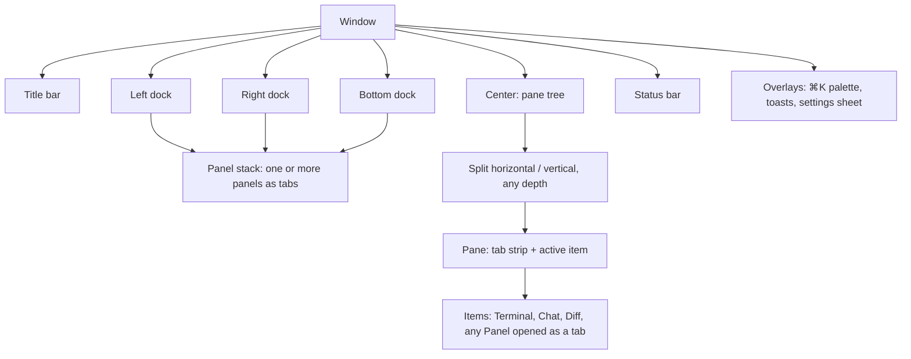
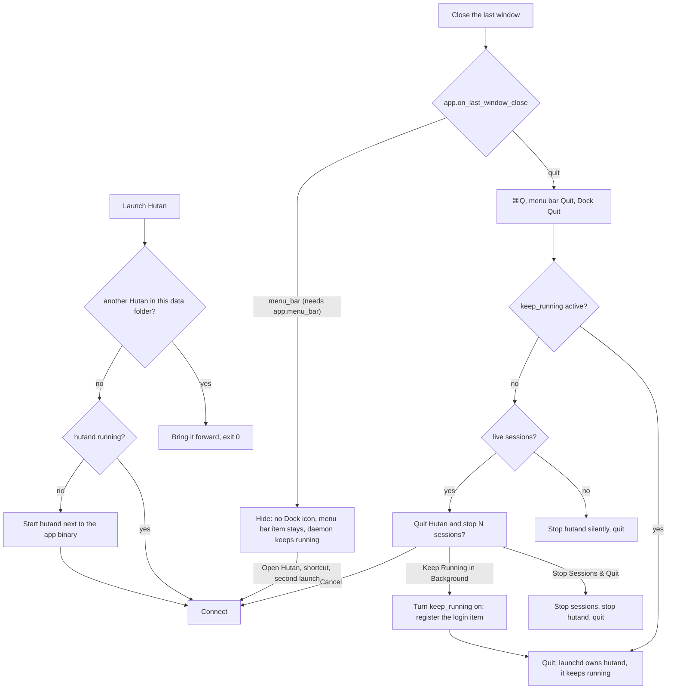

# Hutan Design

Decisions taken with the user (2026-10-14):

| Topic | Decision |
|---|---|
| Layout | **A + B-overview + ⌘K**: sidebar + panes + inspector by default; Overview board as a preset (⌘⇧O); command palette ⌘K |
| Configurability | **Everything is a movable component.** Any panel can live in any dock or as a center tab; every component has its own settings section; layouts are saved as presets |
| Style | **Native macOS chrome + own terminal themes**: transparent titlebar, vibrancy sidebar, SF Pro UI, system accent, light/dark follows the system; terminal and chat use Hutan themes |
| Density | Setting: `compact` (default) / `comfortable` |
| Agents with TUI and protocol | **One session, view switch Chat / Terminal** in the pane header (M4) |

Architecture of the layout system: ADR 0010.

## Principles

1. **Attention first.** The user always sees who needs them (blocked, approval, done-unread) without hunting.
2. **The terminal is sacred.** Chrome never steals keys from a focused terminal except the documented global shortcuts. Every chrome element can be hidden.
3. **Nothing is fixed.** Placement, visibility, size, and per-component behavior come from layout + settings, not code paths.
4. **Closing UI never kills work silently.** Closing a tab, pane, or window detaches. Stopping a session is an explicit, labelled action. Quitting the app asks what to do with live sessions (see § Daemon lifecycle).
5. **Native feel, calm surface.** System chrome, restrained color; color carries state, not decoration.

## Workbench model



- **Panel**: a registered component with an id, title, icon, default dock, and a typed settings section. Panels: `sessions`, `history`, `inspector`, `overview`, `agents`, `assistant`, `notifications`, later `tasks`, `worktrees`, `providers`, `changes`. The `assistant` panel is described in `docs/assistant.md` § Desktop.
- **Dock**: left, right, bottom. A dock hosts a stack of panels (tabs inside the dock). Docks resize, collapse, and can be emptied.
- **Center**: a binary split tree of panes; each pane has its own tab strip. Items are session views (terminal/chat), diffs, or any panel opened as a tab.
- **Status bar**: an ordered list of status items (`connection`, `sessions`, `attention`, `density`, `theme`, `palette_hint`, …) left and right; each is configurable.
- **Title bar**: transparent with traffic lights; shows the active item title, preset switcher, Overview toggle. Can be hidden into a minimal mode.
- **Presets**: named layouts (`default`, `focus`, `overview`, user-defined). Switching a preset swaps docks/center arrangement without closing sessions.

### Moving things

| Action | Mouse | Keyboard (default) |
|---|---|---|
| Split right / down (new pane starts a new terminal in the focused terminal's cwd) | pane menu | ⌘D / ⌘⇧D |
| Move tab to split | drag tab to a pane edge (drop zones) | ⌘K → "Move tab to new split…" |
| Move panel to another dock | drag panel tab to dock, or panel menu "Move to ▸" | ⌘K → "Move panel…" |
| Open panel as center tab | panel menu "Open as tab" | ⌘K |
| Resize | drag splitter / dock edge | ⌃⌘←→↑↓ |
| Focus neighbour | — | ⌘⌥←→↑↓ |
| Zoom pane | double-click tab | ⌘⇧↩ |
| Toggle docks | — | ⌘B left, ⌘⌥B right, ⌘⌥J bottom |
| Switch preset / Overview | title bar menu | ⌘⇧O overview, ⌘⇧1…9 presets |
| Save current layout as preset | title bar menu | ⌘K → "Save layout as preset…" |
| Close tab (detach) | × on tab | ⌘W |
| Stop session | session menu (confirm if running) | ⌘⇧W |

## Default layout

```svg
<svg viewBox="0 0 960 540" xmlns="http://www.w3.org/2000/svg" font-family="system-ui, -apple-system, sans-serif">
  <rect x="0.5" y="0.5" width="959" height="539" rx="10" fill="var(--surface)" stroke="var(--border)"/>
  <rect x="0.5" y="0.5" width="219" height="515" rx="10" fill="var(--border)" opacity="0.28"/>
  <circle cx="18" cy="18" r="6" fill="var(--error)" opacity="0.8"/><circle cx="36" cy="18" r="6" fill="var(--warning)" opacity="0.8"/><circle cx="54" cy="18" r="6" fill="var(--success)" opacity="0.8"/>
  <text x="420" y="22" font-size="12" fill="var(--muted)">M2 · claude — hutan</text>
  <rect x="742" y="9" width="96" height="20" rx="5" fill="none" stroke="var(--border)"/><text x="752" y="23" font-size="11" fill="var(--fg)">Layout: Default ▾</text>
  <rect x="846" y="9" width="104" height="20" rx="5" fill="none" stroke="var(--border)"/><text x="856" y="23" font-size="11" fill="var(--fg)">⊞ Overview ⌘⇧O</text>
  <line x1="220" y1="36" x2="960" y2="36" stroke="var(--border)"/>
  <rect x="10" y="44" width="200" height="24" rx="6" fill="var(--surface)" stroke="var(--border)"/><text x="20" y="60" font-size="11" fill="var(--muted)">⌕ Search sessions</text>
  <text x="12" y="88" font-size="10" fill="var(--warning)" font-weight="700">NEEDS YOU · 2</text>
  <circle cx="18" cy="104" r="4" fill="var(--warning)"/><text x="28" y="108" font-size="12" fill="var(--fg)">api · codex</text><text x="182" y="108" font-size="10" fill="var(--muted)">1m</text>
  <text x="28" y="121" font-size="10" fill="var(--muted)">approval · cargo test</text>
  <circle cx="18" cy="138" r="4" fill="var(--success)"/><text x="28" y="142" font-size="12" fill="var(--fg)">web · omp</text><text x="182" y="142" font-size="10" fill="var(--muted)">4m</text>
  <text x="28" y="155" font-size="10" fill="var(--muted)">done · 3 files changed</text>
  <text x="12" y="180" font-size="10" fill="var(--muted)" font-weight="700">HUTAN  ·  master</text>
  <rect x="8" y="188" width="204" height="24" rx="5" fill="var(--accent)" opacity="0.18"/>
  <text x="16" y="204" font-size="11" fill="var(--c3)">◆</text><text x="30" y="204" font-size="12" fill="var(--fg)">M2 · claude</text>
  <rect x="122" y="193" width="58" height="14" rx="3" fill="none" stroke="var(--border)"/><text x="127" y="203" font-size="9" fill="var(--muted)">wt m2-shell</text><circle cx="198" cy="200" r="4" fill="var(--accent)"/>
  <text x="16" y="228" font-size="11" fill="var(--muted)">❯</text><text x="30" y="228" font-size="12" fill="var(--fg)">tests</text>
  <rect x="142" y="217" width="38" height="14" rx="3" fill="none" stroke="var(--border)"/><text x="148" y="227" font-size="9" fill="var(--muted)">main</text><circle cx="198" cy="224" r="4" fill="var(--accent)"/>
  <text x="16" y="252" font-size="11" fill="var(--muted)">❯</text><text x="30" y="252" font-size="12" fill="var(--fg)">zsh</text><circle cx="198" cy="248" r="4" fill="var(--muted)"/>
  <text x="16" y="276" font-size="11" fill="var(--c5)">✦</text><text x="30" y="276" font-size="12" fill="var(--fg)">ask · sonnet</text><circle cx="198" cy="272" r="4" fill="var(--muted)"/>
  <text x="12" y="302" font-size="10" fill="var(--muted)" font-weight="700">▸ ZAMAN-API  ·  3</text>
  <text x="12" y="500" font-size="11" fill="var(--muted)">＋ New session   ⌘T</text>
  <line x1="220" y1="36" x2="220" y2="516" stroke="var(--border)"/>
  <rect x="220" y="36" width="270" height="28" fill="var(--border)" opacity="0.18"/>
  <text x="232" y="54" font-size="11" fill="var(--fg)">❯ omp</text><text x="276" y="54" font-size="11" fill="var(--muted)">×</text>
  <text x="296" y="54" font-size="11" fill="var(--muted)">❯ zsh</text>
  <line x1="220" y1="64" x2="490" y2="64" stroke="var(--border)"/>
  <g font-family="ui-monospace, Menlo, monospace" font-size="11">
    <text x="232" y="84" fill="var(--c4)">  ▄▀▀▄ █▀▄▀▄ █▀▀▄</text>
    <text x="232" y="98" fill="var(--c4)">  ▀▄▄▀ █ █ █ █▄▄▀  v18.10.3</text>
    <text x="232" y="122" fill="var(--muted)">Tip: ⌥P switches provider</text>
    <text x="232" y="146" fill="var(--fg)">● Reading crates/client/src…</text>
    <text x="232" y="160" fill="var(--fg)">● Editing connection.rs</text>
    <text x="232" y="174" fill="var(--success)">  + reconnect with backoff</text>
    <text x="232" y="188" fill="var(--error)">  - TODO resume</text>
    <text x="232" y="468" fill="var(--muted)">π › Opus 5.5 › hutan ▶ 12%</text>
    <text x="232" y="488" fill="var(--fg)">╰─ continue with M2.2</text>
  </g>
  <rect x="356" y="478" width="7" height="13" fill="var(--accent)"/>
  <line x1="490" y1="36" x2="490" y2="516" stroke="var(--border)"/>
  <rect x="491" y="36" width="209" height="28" fill="var(--border)" opacity="0.18"/>
  <text x="502" y="54" font-size="11" fill="var(--fg)">◆ api · codex</text>
  <rect x="600" y="43" width="92" height="16" rx="4" fill="none" stroke="var(--border)"/>
  <rect x="601" y="44" width="44" height="14" rx="3" fill="var(--accent)" opacity="0.25"/>
  <text x="608" y="55" font-size="9" fill="var(--fg)">Chat</text><text x="650" y="55" font-size="9" fill="var(--muted)">Terminal</text>
  <line x1="490" y1="64" x2="700" y2="64" stroke="var(--border)"/>
  <rect x="540" y="74" width="150" height="34" rx="8" fill="var(--accent)" opacity="0.16"/>
  <text x="550" y="95" font-size="11" fill="var(--fg)">Fix the flaky resume test</text>
  <text x="502" y="126" font-size="11" fill="var(--fg)">Found a race in replay_after.</text>
  <rect x="500" y="134" width="190" height="24" rx="5" fill="none" stroke="var(--c2)"/>
  <text x="510" y="150" font-size="10" fill="var(--c2)">⚙ read bus.rs  ·  ✓  ▸</text>
  <rect x="500" y="164" width="190" height="24" rx="5" fill="none" stroke="var(--c2)"/>
  <text x="510" y="180" font-size="10" fill="var(--c2)">✎ edit bus.rs  +12 −3  ▸</text>
  <rect x="500" y="196" width="190" height="62" rx="6" fill="none" stroke="var(--warning)" stroke-width="1.5"/>
  <text x="510" y="213" font-size="10" fill="var(--warning)" font-weight="700">Approval needed</text>
  <text x="510" y="229" font-size="11" fill="var(--fg)" font-family="ui-monospace, Menlo, monospace">cargo test -p daemon</text>
  <rect x="510" y="236" width="56" height="16" rx="4" fill="var(--accent)"/><text x="518" y="248" font-size="10" fill="var(--surface)">Allow ⌘↩</text>
  <rect x="572" y="236" width="52" height="16" rx="4" fill="none" stroke="var(--border)"/><text x="580" y="248" font-size="10" fill="var(--fg)">Always</text>
  <rect x="630" y="236" width="52" height="16" rx="4" fill="none" stroke="var(--border)"/><text x="640" y="248" font-size="10" fill="var(--fg)">Deny ⎋</text>
  <line x1="491" y1="290" x2="700" y2="290" stroke="var(--border)"/>
  <rect x="491" y="290" width="209" height="24" fill="var(--border)" opacity="0.18"/>
  <text x="502" y="306" font-size="11" fill="var(--fg)">❯ tests</text><text x="560" y="306" font-size="10" fill="var(--accent)">● running</text>
  <g font-family="ui-monospace, Menlo, monospace" font-size="10">
    <text x="502" y="330" fill="var(--muted)">running 203 tests</text>
    <text x="502" y="344" fill="var(--success)">test bus::replay … ok</text>
    <text x="502" y="358" fill="var(--success)">test conn::slow … ok</text>
  </g>
  <rect x="500" y="474" width="190" height="32" rx="7" fill="none" stroke="var(--border)"/>
  <text x="510" y="494" font-size="11" fill="var(--muted)">Message codex…   gpt-5.6-sol ▾</text>
  <line x1="700" y1="36" x2="700" y2="516" stroke="var(--border)"/>
  <text x="714" y="56" font-size="11" fill="var(--fg)" font-weight="600">Approvals</text>
  <text x="784" y="56" font-size="11" fill="var(--muted)">Changes</text><text x="846" y="56" font-size="11" fill="var(--muted)">Info</text>
  <text x="934" y="56" font-size="11" fill="var(--muted)">⚙</text>
  <line x1="700" y1="64" x2="960" y2="64" stroke="var(--border)"/>
  <rect x="712" y="76" width="236" height="80" rx="6" fill="none" stroke="var(--warning)"/>
  <text x="722" y="94" font-size="11" fill="var(--fg)">api · codex</text><text x="900" y="94" font-size="10" fill="var(--muted)">1m</text>
  <text x="722" y="112" font-size="11" fill="var(--fg)" font-family="ui-monospace, Menlo, monospace">cargo test -p daemon</text>
  <text x="722" y="128" font-size="10" fill="var(--muted)">cwd ~/proj/zaman-api (main)</text>
  <text x="722" y="146" font-size="10" fill="var(--accent)">Allow   ·   Always   ·   Deny</text>
  <text x="714" y="182" font-size="10" fill="var(--muted)" font-weight="700">CHANGES · web · omp</text>
  <text x="714" y="202" font-size="11" fill="var(--fg)">src/app.tsx</text><text x="900" y="202" font-size="10" fill="var(--success)">+42</text><text x="928" y="202" font-size="10" fill="var(--error)">−7</text>
  <text x="714" y="220" font-size="11" fill="var(--fg)">src/api.ts</text><text x="900" y="220" font-size="10" fill="var(--success)">+8</text><text x="928" y="220" font-size="10" fill="var(--error)">−2</text>
  <text x="714" y="238" font-size="11" fill="var(--fg)">README.md</text><text x="900" y="238" font-size="10" fill="var(--success)">+3</text>
  <line x1="0" y1="516" x2="960" y2="516" stroke="var(--border)"/>
  <circle cx="14" cy="528" r="3.5" fill="var(--success)"/><text x="24" y="532" font-size="10" fill="var(--muted)">hutand connected</text>
  <text x="140" y="532" font-size="10" fill="var(--muted)">7 sessions</text>
  <text x="214" y="532" font-size="10" fill="var(--warning)">● 2 need you</text>
  <text x="742" y="532" font-size="10" fill="var(--muted)">Compact · Hutan Dark · ⌘K</text>
</svg>
```

Left dock: `sessions` panel (vibrancy) with `history` as a second tab. Center: two-column split; right column split again (chat over terminal). Right dock: `inspector` panel. Status bar: `connection`, `sessions`, `attention` | `density`, `theme`, `palette_hint`.

### Presets shipped

| Preset | Left dock | Center | Right dock | Bottom dock | Use |
|---|---|---|---|---|---|
| `default` | sessions, history | pane tree | inspector, agents | hidden | daily work |
| `focus` | hidden | pane tree, zoomed active pane | hidden | hidden | deep terminal work (layout C) |
| `overview` | sessions, history | `overview` panel as the only center item | inspector, agents | hidden | many agents at once (layout B) |

## Session pane header

`[kind icon] title  [state chip]  [placement badge]  [Chat | Terminal]  … ⋯`

- Kind icon: `❯` terminal, `◆` coding agent, `✦` direct model chat.
- State chip: see attention model. Hidden for plain idle shells unless enabled.
- Placement badge: `main` (main checkout) or `wt <branch>` (worktree); click → reveal in Finder / copy path.
- View switch: only when the session has both a TUI and a structured protocol (M4).
- `⋯` menu: rename, restart, stop, move to split/dock, copy session id, open in new window.

## Attention model

| State | Color token | Indicator | Meaning |
|---|---|---|---|
| `blocked` / approval | `--warning` (system orange) | filled dot, pulses once on entry | needs a decision |
| `done` (unread) | `--success` (system green) | filled dot until viewed | finished, not looked at |
| `working` | `--accent` (system accent) | dot with subtle activity ring | running a turn / output active |
| `idle` | `--muted` | hollow dot (optional) | alive, waiting |
| `failed` / exited ≠ 0 | `--error` (system red) | dot + code in subtitle | needs a look |

Rollups: session → workspace header → sidebar "Needs you" → status bar `attention` item → menu bar item and Dock badge (M6-C, § macOS integration) → notification (M6-B).

## Visual system

- **Chrome**: transparent titlebar with inset traffic lights; vibrancy (blurred, translucent) sidebar dock; opaque center and right dock. Light/dark follows macOS. Accent = system accent color. GPUI support for transparent titlebar and blurred window background is verified in M2.1 `[UNVERIFIED]`.
- **Typography**: UI = system font (SF Pro) 12 pt compact / 13 pt comfortable; section headers 10 pt semibold uppercase tracking +4 %; monospace = configurable, default `Menlo` 13 pt (SF Mono is not installed system-wide).
- **Density tokens**:

| Token | compact | comfortable |
|---|---|---|
| sidebar row | 24 px | 30 px |
| tab height | 28 px | 32 px |
| pane header | 28 px | 34 px |
| status bar | 22 px | 26 px |
| base spacing | 4 px | 6 px |
| corner radius | 6 px | 8 px |
| terminal padding (all sides) | 6 px | 8 px |
| block gutter bar | 3 px | 4 px |

- **Themes**: one theme definition drives chrome, terminal palette, and (M11) syntax scopes; built-in `hutan-dark` (terminal bg `#1e1e1e`, fg `#d4d4d4`, matches daemon defaults) and `hutan-light`; follows system appearance unless pinned. Later: import Ghostty/Zed theme files. The desktop reports the active terminal colors to the daemon so OSC 10/11 replies match what the user sees.
- **Motion**: ≤ 150 ms, ease-out; no motion on terminal content; respects Reduce Motion.

## Settings

- Files (TOML, comments allowed):
  - user: `~/Library/Application Support/Hutan/settings.toml`
  - keymap: `~/Library/Application Support/Hutan/keymap.toml`
  - workspace overrides: `<repo>/.hutan/settings.toml` (only keys marked workspace-overridable)
- Precedence: built-in defaults < user < workspace < runtime toggles (e.g. density switch writes back to user file).
- Every component owns one namespace with a typed, documented schema; unknown keys warn, invalid values fall back to defaults with a visible error in the settings UI. Files hot-reload.
- Settings UI (⌘,): generated from the schemas, searchable; each panel's gear (⚙) opens its own section.
- `terminal` namespace, session start (B-1): `shell` (string; empty = the account's login shell) and `env` (table of strings, extra variables) are overridable per workspace; `<repo>/.hutan/settings.toml` `terminal.env` overrides the user's per variable. They are resolved for the workspace a new terminal starts in (its first root, which need not be the one on screen) and sent in `session.create` as `TerminalSpec.env` (`shell` as `SHELL`). Values are passed to the daemon and never logged or shown. Where the rest of the environment comes from: `daemon.toml` `[terminal] env_inherit` (`docs/architecture.md` § Session environment).
- Layout geometry the user drags (sizes, open tabs, split ratios) is **state**, saved in `desktop-state.json`; it becomes a **preset** in settings only when the user saves it.

```toml
[app]
keep_running = false          # keep the daemon running after Hutan quits: registers the launch agent (Hutan.app only)
on_last_window_close = "quit" # quit | menu_bar (keep Hutan in the menu bar; needs menu_bar = true)
menu_bar = true               # menu bar item: daemon state, count, sessions that need you
dock_badge = true             # number of sessions that need you on the Dock icon

[assistant]
global_shortcut = "alt-space" # system-wide shortcut that opens the Assistant; "" turns it off

[appearance]
density = "compact"            # compact | comfortable
chrome = "system"              # system | light | dark

[terminal]
font_family = "Menlo"
font_size = 13
theme = "auto"                 # auto | hutan-dark | hutan-light | <name>
cursor = { style = "block", blink = true }
option_as_meta = "left"        # none | left | right | both
copy_on_select = false
blocks = true                  # prompt blocks over the terminal (see Terminal blocks)

[layout]
preset = "default"

[layout.presets.default]
left   = { panels = ["sessions"],  size = 240, visible = true }
right  = { panels = ["inspector", "agents"], size = 300, visible = true }
bottom = { panels = [],            size = 200, visible = false }
status_bar = { left = ["connection", "workspace", "sessions", "attention"], right = ["density", "theme", "palette_hint"] }

[panels.sessions]
group_by = "workspace"         # workspace | state | none
needs_you = true
row = ["state", "kind", "title", "placement", "age"]

[panels.inspector]
tabs = ["approvals", "changes", "info"]
reveal_on_approval = true

[panels.overview]
card_size = "medium"           # small | medium | large
preview = "live"               # live | static | off
sort = "attention"             # attention | recent | name

[workspaces]
sort = "manual"                # manual | recent | attention | name
hide_empty = true              # hide workspaces without sessions
hide_sleeping = false          # hide workspaces without a live session
hide_cli_created = false       # hide workspaces the CLI or an agent created
always_show_active = true      # the workspace you are in stays listed whatever the filters say

[history]
sources = []                   # default source chips: hutan | claude | codex | omp (empty = all)
roles = []                     # default role chips: user | assistant | tool | command | output
range = "all"                  # 24h | 7d | 30d | all
project = "all"                # workspace | all
show_snippets = true

[agents]
show_finished = false          # list finished agents (dimmed, their subtree folded into one row)
only_blocked = false           # list only blocked agents (and the ones above them)
scope = "active_workspace"     # active_workspace | all
```

## Projects and workspaces (M12-B)

The daemon owns workspaces (protocol 0.6: kind, pin, order, activity, session counts, recent projects); the desktop decides how to show them. The sidebar (`sessions` panel, titled "Workspaces") lists them with their sessions.

- **Rows**: `▾ ⌂ ★ NAME  ·····  ● 2  3` — chevron folds the sessions, `⌂` marks Home, `★` a pin, `● n` sessions that need you, then the session count (`live/total` when they differ). Click shows the workspace; right-click opens its menu; the active one is tinted.
- **Sort** (header button `⇅ Manual ▾`, ⌘K, `workspaces.sort`): `manual` (drag order; Home leads the unpinned ones) · `recent` (last activity) · `attention` (most sessions that need you, then activity) · `name`. Pinned workspaces come first in every mode under a `PINNED` label; ties keep the daemon's order.
- **Drag** a row onto another to reorder (manual only): it takes that row's slot within its group (pinned or not); onto Home it goes first below Home; Home itself does not move. The desktop sends `workspace.move`; the daemon stores the order.
- **Filters** (`workspaces.*`, the same header menu, ⌘K): hide empty / sleeping / CLI-created workspaces. Home, pinned workspaces and (`always_show_active`) the active one are never hidden, and a session that needs you stays visible in "Needs you" whatever the filters say. The filter box matches names and folders (any word order); a workspace that matches lists all its sessions. Hidden workspaces stay reachable through ⌘J.
- **Menu**: Pin/Unpin, Rename…, Add Folder… (system folder panel → `workspace.add_root`), Remove Folder “x” (when there are several roots), Close (greyed with the reason while sessions are live and for Home; asks first, the project stays in ⌘O), Reveal in Finder. Home has one folder, set in `daemon.toml`.
- **⌘O** lists "Open Folder…" and the recent projects (`workspace.recent`, ▣ open · ▢ closed) with a fuzzy filter; Enter runs `workspace.open` and shows the workspace. **⌘J** lists every workspace and every session; Enter shows it.
- **One layout per workspace** (`desktop-state.json`: `active_workspace` + `parked`): the center pane tree, docks, zoom, focus and preset belong to the workspace you are in; switching parks them and brings the other one back exactly. A workspace seen for the first time starts with a single pane under your dock arrangement. Opening a session of another workspace (sidebar, ⌘J, attention, a restored tab) switches first. Terminals of parked workspaces are **detached**, so nothing outside the window renders or is acked; coming back re-attaches with a daemon snapshot (two terminals ≈ 70 ms in the GPUI test, polling included), which is why attached-but-hidden was not chosen. A layout saved before workspaces existed belongs to the workspace of its first session (else Home); a workspace that vanishes hands the window to Home and its layout is dropped.
- **Settings**: the first root of the active workspace layers `<root>/.hutan/settings.toml` over the user settings (hot-reloaded, also while it stays active), whether or not a session has focus. New sessions (⌘T, splits of a pane without a session) start in the active workspace, else in Home.
- **Status bar**: the `workspace` item shows the active workspace; click opens ⌘J.

## History panel (M17-B)

The `history` panel searches the opt-in session history index (`docs/history-index.md`, protocol 0.8 `history.*`): Hutan terminal blocks and the transcripts of Claude Code, Codex and OMP. It lives in the left dock as a tab next to Sessions in every built-in preset and moves like any panel; ⌘K → "Panel: Open History" reveals it.

- **Disabled** (`history.status.enabled = false`, the default): the panel says what turning indexing on reads (the four sources and their default folders), that nothing leaves the machine and that Clear deletes the index, and offers **Enable indexing** (`history.set_enabled`) and a link to the `history` settings. No search is sent while indexing is off.
- **Search**: a field (debounced 150 ms, `history.search`, 50 sessions) under which filter chips narrow the same search — source (Hutan / Claude / Codex / OMP), role (user · assistant · tool · command · output), date (24h / 7d / 30d / all), project (this workspace = the first folder of the active workspace · all). Chips are toggles; none chosen means all. One row per session: source glyph, title, age, `source · role · folder · N hits`, and the best snippet with the matching words **emphasised** (the index's `«…»` markers are parsed, never drawn). ↑ ↓ select a row, ↩ runs its main action.
- **Row actions**: **Resume** opens a new terminal session running the hit's `resume_argv` (greyed with the reason when the index has none: Hutan records, ids the resume rules refuse). It starts in the active workspace when one of its folders holds the hit's directory, otherwise `workspace.open` finds or creates the workspace that contains it and the window switches there (Home is a catch-all and only counts for its own folder). A directory that no longer exists falls back to the active workspace's first folder, and a notice says so. **Copy command** puts the shell-quoted resume line on the clipboard. **Open Block** / **Open Session** (Hutan hits): shows the terminal session and scrolls it to the block the hit names (`terminal_id` + `block_id`, exact: no time matching) while the session still has that terminal and the block; otherwise a notice says it is gone. **Reveal File** (hits of Claude Code, Codex and OMP) shows the transcript file (`path`) in Finder. Transcript files are not revealed in Finder: a hit does not carry its path (and no block id) yet.
- **Footer**: rows, database size, unreadable lines, per-source last indexed time, **Clear…** and **Rebuild…** (both ask first; Clear deletes `index.sqlite`, Hutan's own records cannot come back). While the index fills (after Enable, Rebuild, Clear, or when the panel opens on an empty index) the panel reads the status twice a second and searches again when the row count changes, until it stays put for 2 s (10 s while empty, 60 s at most).
- **⌘K**: "History: Search History…" reveals the panel and focuses its field. **⌘J**: a query that starts with `?` searches the history inline (top 8 sessions, same filter defaults); ↩ resumes the hit when it can be resumed, else shows it in the panel with the field filled in and the row selected.
- **Settings** (`history`, desktop side only; whether indexing runs and where the transcripts are belongs to `daemon.toml`): `sources` / `roles` (default chips, empty = all), `range` (`24h` | `7d` | `30d` | `all`), `project` (`workspace` | `all`), `show_snippets`.

## Agent monitor (M13-B)

The `agents` panel (default: second tab of the right dock in `default`, `focus` (hidden) and `overview`; movable like every panel) draws the daemon's observation tree (`agent.tree`, `agent.tree_updated`, `docs/protocol.md` § Agent observation tree) of every session that has one. The daemon owns the tree; the panel only filters and draws.

- **Sections**: one per session with agents, headed `workspace › session title` (click focuses the session), workspaces in the sidebar's manual order, sessions in creation order. Under it the tree, indented: main agent first, siblings in the order they started (then by id, so rows never jump when a node changes).
- **Row**: state glyph, name (else agent type, else the agent program or node id), the agent type when it is not the name, model, duration, and a second line with usage and the current activity (one line, 80 characters). Glyphs are never color alone: `●` working (accent, pulses once a second; steady under Reduce Motion), `▲` blocked (warning), `○` idle, `?` unknown (muted; the main agent after a daemon restart until it reports), and for finished agents their outcome: `✓` completed (success), `✗` failed (error), `⊘` interrupted, `⏹` disconnected (muted). Finished rows are dimmed.
- **Duration** runs from `started_at_ms` (to `ended_at_ms` once finished). It refreshes once a second only while the panel is drawn and a listed agent works or waits for the user; a hidden panel, or a tree with nothing running, wakes nothing.
- **Usage** is labelled by `usage.kind`, never zero-filled: `1.5k tok · context` (`claude.context`: the latest context, `3.2k/200k` with a window), `3.2k tok · total · $0.31` (`codex.total`), `800 tok · excl. cache` (`omp.tokens` leaves cache reads out). A kind this build does not know shows as the source sent it.
- **Finished subtrees** (a finished agent whose descendants all finished) are hidden unless `agents.show_finished`, and then folded into their head row (`▸ +3`; the chevron unfolds). A finished agent with a live descendant stays, so the tree stays connected. **Blocked agents are always listed**, with the agents above them.
- **Chips** at the top toggle `agents.show_finished`, `agents.only_blocked` and `agents.scope` (this workspace · all workspaces) in `settings.toml`. ⌘K: *Agents: Show Monitor*, *Agents: Show Only Blocked*.
- **Click** a row to focus its session (its terminal or chat tab). **Right-click**: Open Session, *Open Transcript* (only for nodes that reported a `transcript_path`; reveals it in Finder), Copy Node ID.
- **Badges**: a session's row in the sidebar, its tab and its overview card show `↳2` (subagents working or waiting for you) and `▲` (any node blocked); the tooltip says `2 subagents running` / `Blocked: reviewer`. Nothing is drawn while there is nothing to say.
- **Attention**: a live session with a blocked node always needs the user (`SessionsStore::presentation` folds the tree over the session summary), so the sidebar's *Needs you*, ⌘⇧J, the workspace counts and the status bar's `attention` item include it. `SessionsStore` emits `AgentAttentionChanged { session_id, blocked_nodes }` when a node becomes blocked (not for what was already blocked when the window connected, not when one is resolved); M6 turns it into a macOS notification.

## Terminal blocks (M10-C)

The daemon indexes OSC 133 marks into blocks (protocol 0.5); the desktop draws them **over the single grid** — the grid, its columns and the PTY size never change, and `terminal.blocks = false` makes the terminal look exactly as without blocks (hot-reloaded).

- **Gutter**: a thin bar at the left edge, inside the terminal padding (width = the `block gutter bar` density token), one per block from its prompt to the end of its output. `--success` after exit 0, `--error` after a failure, neutral (`--muted`) while the command runs and when no exit code is known; the bar of a running block pulses slowly (steady under Reduce Motion, read from macOS; `HUTAN_REDUCE_MOTION=0|1` overrides). The open prompt has no bar.
- **Separator** above every prompt but the first row, and a right-aligned **chip** on the prompt line: `✓ 1.2 s`, `✗ 2 3 m` (exit status, duration). A chip never covers text the prompt line shows: when the line is too full for it, it is left out.
- **Hover** a block: a faint tint and an actions bar at the right of its first visible row — Copy command, Copy output (both through `terminal.block_text`, so they work beyond the loaded scrollback), Collapse / Expand, Rerun (types the command and Enter into the session; off while a command runs), Send to agent (a chip in the composer of the last-focused chat, `docs/agents.md`).
- **Collapse** folds a finished block's output rows into one summary row (`… 241 lines, exit 0`) *in the view only*: nothing changes in the PTY, the scrollback or what other clients see, and older lines move down to fill the freed rows (the view stays anchored at its bottom). Folds apply to the pane, not to overview previews; they are saved per terminal in `desktop-state.json` (`collapsed_blocks`, terminal id → block ids) so they survive a desktop restart, and are forgotten with the terminal.
- **Keyboard**: ⌘↑ / ⌘↓ move the highlight to the previous / next prompt and scroll to it (past the newest block ⌘↓ returns to the live screen; typing clears the highlight); ⌘⇧A selects the current block's output, ⌘⇧C copies it. The *current* block is the highlighted one, else the newest command with output. Every action is also in ⌘K under `Block:`.
- **Overview previews** show the gutter colors only (no chips, separators or folds). The inspector's Info tab lists the last 20 commands of the focused terminal (command, exit, duration, cwd); a click scrolls that terminal to the block.

## Daemon lifecycle

**The daemon follows the app**, unless the user asks it to outlive it. The app starts `hutand` when none is running; it keeps it for as long as Hutan runs (a window is open, or Hutan sits in the menu bar); quitting stops it. One toggle changes that: `app.keep_running` ("Keep daemon running after Hutan quits", default off).



- **Closing the last window** (`app.on_last_window_close`, default `quit`): `quit` is ⌘Q (the window stays until the flow has decided). `menu_bar` keeps Hutan alive in the menu bar: the window is hidden, not destroyed (it holds the connection, the sessions and the layout the menu bar item serves), the activation policy becomes *accessory* (no Dock icon, no application menu), and the daemon keeps running until Quit. Opening Hutan from the menu bar item, the global shortcut, a notification, a second launch or the Dock brings back the window and the Dock icon. `menu_bar` needs `app.menu_bar = true` (nothing would be left to reopen Hutan from): without it closing the last window quits, and the settings show a diagnostic for `app.on_last_window_close`. Turning the menu bar item off while Hutan is hidden shows the window again. Closing any other window just closes it; closing a tab or pane only detaches.
- **Quit** is the same flow from ⌘Q, the app menu, the menu bar item and (best effort) the Dock. With *keep running* off the daemon stops with Hutan: silently when no session is live, after the confirmation when some are (the title counts them: "Quit Hutan and stop 1 live session?"). *Keep Running in Background* turns `app.keep_running` on (registering the login item; outside Hutan.app, where there is none, it just leaves the daemon running) and quits; if the system refuses the registration Hutan stays open and says why. With keep running *active* (registered and approved) nothing is asked and nothing is stopped.
- **The Dock's Quit, logout and shutdown** reach the app as a platform termination with no window to ask in, so the app cannot ask: an idle daemon is stopped as with ⌘Q, one with live sessions is left running with them (as after a signal). [The Dock's Quit could be routed through the confirmation by taking over `applicationShouldTerminate:` from GPUI's delegate; that is not done because the same hook decides whether logout may proceed.]
- **SIGTERM / SIGINT / SIGHUP** quit cleanly without touching the daemon, never asking (unchanged): layout saved, connection closed, exit code 0.
- **Single instance.** One Hutan desktop per data folder (`HUTAN_HOME`, else `~/Library/Application Support/Hutan`). `LSMultipleInstancesProhibited` makes Launch Services reactivate the running app for the Dock and Finder; the executable enforces it itself too (running the binary directly, `open -n`): it takes an exclusive `flock` on `desktop.lock` in the data folder before any window opens, and a second desktop that finds it held connects to `desktop.sock` (owned by the first, `0600`, peers of another user dropped), sends `{"cmd":"activate"}` and exits 0 at once. The first one brings its window forward (from the menu bar, from behind other apps), or opens a new one if there is none. A lock or socket left by a crashed desktop is harmless: the lock goes with the process and the lock holder replaces a stale socket file. Code: `crates/desktop/src/instance.rs`.
- **Daemon controls** — the same set in three places: the `Daemon` menu (menu bar), a popover opened by clicking the `connection` status item, and ⌘K commands:
  - status: connected/reconnecting, daemon version + protocol, pid, uptime, sessions (live / total), clients, socket path, log path;
  - actions: Restart Daemon, Stop Daemon (both confirm when sessions are live: they stop; the app stays open and shows "daemon stopped" with a Start button), Start Daemon (when stopped), Open Logs;
  - the **Keep daemon running after Hutan quits** switch bound to `app.keep_running`, with the system's status in its title when it is not plain `enabled`, and *Open Login Items* (enabled while the status is `requires approval`).
- The CLI (`hutan daemon start|status|stop|restart`) controls the same daemon; the app reflects CLI-initiated stops/restarts through its reconnect state.
- Quitting is always clean: layout saved, connection closed, exit code 0; the daemon is stopped through `daemon.shutdown`, never killed. A desktop panic writes message + backtrace to `desktop.log` before exiting.
- A `settings.toml` from before this model may still have `app.on_quit`: the key is gone, so it is ignored with the settings' "unknown key (ignored)" warning, not an error.

## macOS integration (M6-C)

Code: `crates/desktop/src/macos/` (the four system APIs, each behind a trait with a fake) and `workbench/mac.rs` (the workbench side). `MacServices::system()` builds the real ones and only `app::run` calls it; every GPUI test uses the fakes, so no test touches `SMAppService`, `NSStatusBar`, the Dock tile or the hotkey API.

- **Keep daemon running after Hutan quits** (`app.keep_running`, Settings → `app`, the `Daemon` menu, the daemon popover and the menu bar menu). On → `SMAppService.agent(plistName: "dev.hutan.daemon.plist").register()`; off → `unregister()`; the file is the truth, so editing `settings.toml` does the same and a window opened with the setting on registers the agent. The status sits next to the toggle: `enabled`, `requires approval` (button *Open Login Items* → `SMAppService.openSystemSettingsLoginItems()`), `not registered`, `not found` (a registration that ends `not found`, or that the system refuses, is reported and the setting goes back to off). It is re-read when the window becomes active, so approving in System Settings is picked up. Only available when the executable is `*.app/Contents/MacOS/*` **and** the main bundle is `dev.hutan.Hutan`; elsewhere the toggle is disabled with "available in Hutan.app" and nothing is registered.
  - *Active* means registered **and** approved (`enabled`). While active: quitting never asks and never stops the daemon (a daemon without live sessions would otherwise stop with the app), and at start the desktop does **not** spawn `hutand`: its connection is `Connection::start_held`, which only dials. If no daemon answered after 4 s (the user stopped it, or the login item has not run yet) the connection may start one as before (`launchd_grace_over`), unless the user stopped the daemon from the app.
  - Turning it off while sessions run: the app unregisters the agent and the daemon is whatever launchd leaves running; from the next quit on, the daemon follows the app again (§ Daemon lifecycle). [INFERENCE: whether `unregister()` also ends the running agent is not documented by Apple; the integrator's demo checks it, `docs/packaging.md` § Keep running.]
- **Menu bar item** (`app.menu_bar`, default on): the orangutan glyph (`assets/macos/MenuBarIcon.png` 18 px and `@2x` 36 px, black template image tinted by the system, rendered from `assets/brand/05-mascot/svg/favicon.svg` by `just menubar-icon`) and, when something needs you, its count. Menu: the daemon state (`hutand connected` / `stopped` / `reconnecting…`, or the operation in progress), `N need you` with one item per session (title — blocked / approval / failed: detail; at most 10, then "…and N more"; a click brings the window forward and shows the session, an assistant conversation in the Assistant panel), *Open Hutan*, *New Terminal*, *Keep Daemon Running After Hutan Quits* (checkbox, same rules as above), *Quit Hutan* (the usual quit flow, with the window shown first when it has to ask). The item is created when the setting is on and removed when it goes off; hot reload, no restart. `StatusItemModel` is pure data (count, menu rows) derived from the attention model.
- **Dock badge** (`app.dock_badge`, default on): `NSApp.dockTile.badgeLabel` is the number of sessions that need you, empty at zero. The same number as the menu bar item and the same rule: **blocked** (an agent in the session is blocked, or the session waits for an approval), **pending approvals** (a session with a permission request counts once, however many requests), and **unread failures** (exit ≠ 0, a signal or a spawn failure that the user has not looked at). A finished-and-unread session (`done`) is in the sidebar's *Needs you* but not in the badge: a badge says "go and decide" or "something broke". Opening the session marks a failure read; the count drops with it (`SessionsStore::attention_entries`, `attention::classify`).
- **Global shortcut** (`assistant.global_shortcut`, default `alt-space`, empty turns it off): a Carbon hot key (`RegisterEventHotKey`), so no Accessibility permission is needed and it works while any app is in front. Pressing it brings the app forward and runs `OpenAssistant` (the same code as the in-app ⌥Space). Syntax: GPUI keystrokes (`alt-space`, `cmd-shift-k`, `ctrl-f12`); at least one of `cmd`, `ctrl`, `alt` is required so a bare key can never swallow typing everywhere. When registration fails (another app owns it) the window says so **once** and the setting is left as is; changing the setting tries again, other settings reloading does not. An invalid value gets its own notice. The in-app keybinding (`keymap.toml`) is independent of this setting.
- **Events** (a menu choice, the shortcut) travel from the main-thread callbacks to the workbench over one bounded channel (`MacEvent`), drained in a GPUI task; a full queue drops the newest. Nothing is polled.

## Keyboard defaults

| Action | Key |
|---|---|
| Command palette | ⌘K |
| Settings | ⌘, |
| New session (terminal) / new agent / new chat | ⌘T / ⌘⇧T / ⌘⌥T |
| Open / focus the Assistant panel (OS-global registration is M6) | ⌥Space |
| Jump to next "needs you" | ⌘⇧J |
| Tabs 1–9 in pane | ⌘1…⌘9 |
| Split right / down | ⌘D / ⌘⇧D |
| Close tab (detach) / stop session | ⌘W / ⌘⇧W |
| Toggle left / right / bottom dock | ⌘B / ⌘⌥B / ⌘⌥J |
| Open project (recent projects, Open Folder…) | ⌘O |
| Jump to any workspace or session, hidden ones included; `?` + words searches the session history | ⌘J |
| Overview | ⌘⇧O |
| Previous / next prompt (highlights the block) | ⌘↑ / ⌘↓ |
| Select / copy the current block's output | ⌘⇧A / ⌘⇧C |
| Approve / deny focused approval | ⌘↩ / ⎋ (only when the approval card has focus) |

The block keys apply while the primary screen shows (a program on the alternate screen — vim, htop — hides blocks and gets every key). Inside a focused terminal every other key goes to the PTY; Option-as-Meta follows `terminal.option_as_meta`.

## Accessibility

- All chrome reachable by keyboard; visible focus rings (system style).
- State never conveyed by color alone: dot shape/fill + text subtitle.
- VoiceOver labels for panels, panes, session rows; terminal content exposed later (M6 a11y pass).
- Respect Reduce Motion, Increase Contrast.

## Open design questions

1. ~~App icon and name~~ → Hutan, orangutan mascot (`assets/brand/`); app icon `assets/brand/05-mascot/svg/icon-dark.svg`, mascot UX states listed in `assets/brand/README.md`.
2. Where approvals appear when the inspector is hidden: toast + sidebar only (current proposal).
3. Multi-window: one workspace per window vs any (proposal: any; presets per window).
