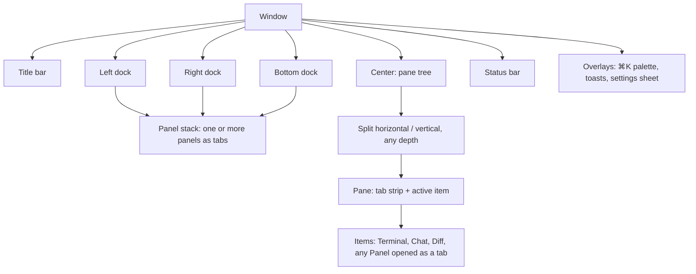
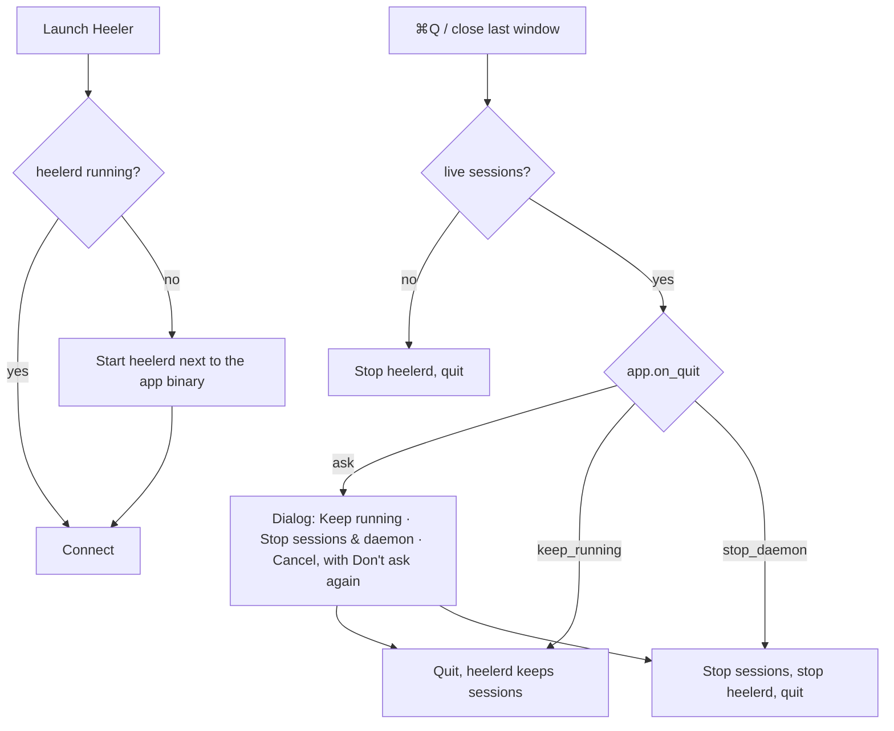

# Heeler Design

Decisions taken with the user (2026-10-14):

| Topic | Decision |
|---|---|
| Layout | **A + B-overview + ⌘K**: sidebar + panes + inspector by default; Overview board as a preset (⌘⇧O); command palette ⌘K |
| Configurability | **Everything is a movable component.** Any panel can live in any dock or as a center tab; every component has its own settings section; layouts are saved as presets |
| Style | **Native macOS chrome + own terminal themes**: transparent titlebar, vibrancy sidebar, SF Pro UI, system accent, light/dark follows the system; terminal and chat use Heeler themes |
| Density | Setting: `compact` (default) / `comfortable` |
| Agents with TUI and protocol | **One session, view switch Chat / Terminal** in the pane header (M4) |

Architecture of the layout system: ADR 0010.

## Principles

1. **Attention first.** The user always sees who needs them (blocked, approval, done-unread) without hunting.
2. **The terminal is sacred.** Chrome never steals keys from a focused terminal except the documented global shortcuts. Every chrome element can be hidden.
3. **Nothing is fixed.** Placement, visibility, size, and per-component behavior come from layout + settings, not code paths.
4. **Closing UI never kills work silently.** Closing a tab, pane, or window detaches. Stopping a session is an explicit, labelled action. Quitting the app asks what to do with live sessions (see § Daemon lifecycle).
5. **Native feel, calm surface.** System chrome, restrained color; color carries state, not decoration.

## Workbench model



- **Panel**: a registered component with an id, title, icon, default dock, and a typed settings section. Panels: `sessions`, `inspector`, `overview`, `notifications`, later `tasks`, `worktrees`, `providers`, `changes`.
- **Dock**: left, right, bottom. A dock hosts a stack of panels (tabs inside the dock). Docks resize, collapse, and can be emptied.
- **Center**: a binary split tree of panes; each pane has its own tab strip. Items are session views (terminal/chat), diffs, or any panel opened as a tab.
- **Status bar**: an ordered list of status items (`connection`, `sessions`, `attention`, `density`, `theme`, `palette_hint`, …) left and right; each is configurable.
- **Title bar**: transparent with traffic lights; shows the active item title, preset switcher, Overview toggle. Can be hidden into a minimal mode.
- **Presets**: named layouts (`default`, `focus`, `overview`, user-defined). Switching a preset swaps docks/center arrangement without closing sessions.

### Moving things

| Action | Mouse | Keyboard (default) |
|---|---|---|
| Split right / down (new pane starts a new terminal in the focused terminal's cwd) | pane menu | ⌘D / ⌘⇧D |
| Move tab to split | drag tab to a pane edge (drop zones) | ⌘K → "Move tab to new split…" |
| Move panel to another dock | drag panel tab to dock, or panel menu "Move to ▸" | ⌘K → "Move panel…" |
| Open panel as center tab | panel menu "Open as tab" | ⌘K |
| Resize | drag splitter / dock edge | ⌃⌘←→↑↓ |
| Focus neighbour | — | ⌘⌥←→↑↓ |
| Zoom pane | double-click tab | ⌘⇧↩ |
| Toggle docks | — | ⌘B left, ⌘⌥B right, ⌘J bottom |
| Switch preset / Overview | title bar menu | ⌘⇧O overview, ⌘⇧1…9 presets |
| Save current layout as preset | title bar menu | ⌘K → "Save layout as preset…" |
| Close tab (detach) | × on tab | ⌘W |
| Stop session | session menu (confirm if running) | ⌘⇧W |

## Default layout

```svg
<svg viewBox="0 0 960 540" xmlns="http://www.w3.org/2000/svg" font-family="system-ui, -apple-system, sans-serif">
  <rect x="0.5" y="0.5" width="959" height="539" rx="10" fill="var(--surface)" stroke="var(--border)"/>
  <rect x="0.5" y="0.5" width="219" height="515" rx="10" fill="var(--border)" opacity="0.28"/>
  <circle cx="18" cy="18" r="6" fill="var(--error)" opacity="0.8"/><circle cx="36" cy="18" r="6" fill="var(--warning)" opacity="0.8"/><circle cx="54" cy="18" r="6" fill="var(--success)" opacity="0.8"/>
  <text x="420" y="22" font-size="12" fill="var(--muted)">M2 · claude — heeler</text>
  <rect x="742" y="9" width="96" height="20" rx="5" fill="none" stroke="var(--border)"/><text x="752" y="23" font-size="11" fill="var(--fg)">Layout: Default ▾</text>
  <rect x="846" y="9" width="104" height="20" rx="5" fill="none" stroke="var(--border)"/><text x="856" y="23" font-size="11" fill="var(--fg)">⊞ Overview ⌘⇧O</text>
  <line x1="220" y1="36" x2="960" y2="36" stroke="var(--border)"/>
  <rect x="10" y="44" width="200" height="24" rx="6" fill="var(--surface)" stroke="var(--border)"/><text x="20" y="60" font-size="11" fill="var(--muted)">⌕ Search sessions</text>
  <text x="12" y="88" font-size="10" fill="var(--warning)" font-weight="700">NEEDS YOU · 2</text>
  <circle cx="18" cy="104" r="4" fill="var(--warning)"/><text x="28" y="108" font-size="12" fill="var(--fg)">api · codex</text><text x="182" y="108" font-size="10" fill="var(--muted)">1m</text>
  <text x="28" y="121" font-size="10" fill="var(--muted)">approval · cargo test</text>
  <circle cx="18" cy="138" r="4" fill="var(--success)"/><text x="28" y="142" font-size="12" fill="var(--fg)">web · omp</text><text x="182" y="142" font-size="10" fill="var(--muted)">4m</text>
  <text x="28" y="155" font-size="10" fill="var(--muted)">done · 3 files changed</text>
  <text x="12" y="180" font-size="10" fill="var(--muted)" font-weight="700">HEELER  ·  master</text>
  <rect x="8" y="188" width="204" height="24" rx="5" fill="var(--accent)" opacity="0.18"/>
  <text x="16" y="204" font-size="11" fill="var(--c3)">◆</text><text x="30" y="204" font-size="12" fill="var(--fg)">M2 · claude</text>
  <rect x="122" y="193" width="58" height="14" rx="3" fill="none" stroke="var(--border)"/><text x="127" y="203" font-size="9" fill="var(--muted)">wt m2-shell</text><circle cx="198" cy="200" r="4" fill="var(--accent)"/>
  <text x="16" y="228" font-size="11" fill="var(--muted)">❯</text><text x="30" y="228" font-size="12" fill="var(--fg)">tests</text>
  <rect x="142" y="217" width="38" height="14" rx="3" fill="none" stroke="var(--border)"/><text x="148" y="227" font-size="9" fill="var(--muted)">main</text><circle cx="198" cy="224" r="4" fill="var(--accent)"/>
  <text x="16" y="252" font-size="11" fill="var(--muted)">❯</text><text x="30" y="252" font-size="12" fill="var(--fg)">zsh</text><circle cx="198" cy="248" r="4" fill="var(--muted)"/>
  <text x="16" y="276" font-size="11" fill="var(--c5)">✦</text><text x="30" y="276" font-size="12" fill="var(--fg)">ask · sonnet</text><circle cx="198" cy="272" r="4" fill="var(--muted)"/>
  <text x="12" y="302" font-size="10" fill="var(--muted)" font-weight="700">▸ ZAMAN-API  ·  3</text>
  <text x="12" y="500" font-size="11" fill="var(--muted)">＋ New session   ⌘T</text>
  <line x1="220" y1="36" x2="220" y2="516" stroke="var(--border)"/>
  <rect x="220" y="36" width="270" height="28" fill="var(--border)" opacity="0.18"/>
  <text x="232" y="54" font-size="11" fill="var(--fg)">❯ omp</text><text x="276" y="54" font-size="11" fill="var(--muted)">×</text>
  <text x="296" y="54" font-size="11" fill="var(--muted)">❯ zsh</text>
  <line x1="220" y1="64" x2="490" y2="64" stroke="var(--border)"/>
  <g font-family="ui-monospace, Menlo, monospace" font-size="11">
    <text x="232" y="84" fill="var(--c4)">  ▄▀▀▄ █▀▄▀▄ █▀▀▄</text>
    <text x="232" y="98" fill="var(--c4)">  ▀▄▄▀ █ █ █ █▄▄▀  v18.10.3</text>
    <text x="232" y="122" fill="var(--muted)">Tip: ⌥P switches provider</text>
    <text x="232" y="146" fill="var(--fg)">● Reading crates/client/src…</text>
    <text x="232" y="160" fill="var(--fg)">● Editing connection.rs</text>
    <text x="232" y="174" fill="var(--success)">  + reconnect with backoff</text>
    <text x="232" y="188" fill="var(--error)">  - TODO resume</text>
    <text x="232" y="468" fill="var(--muted)">π › Opus 5.5 › heeler ▶ 12%</text>
    <text x="232" y="488" fill="var(--fg)">╰─ continue with M2.2</text>
  </g>
  <rect x="356" y="478" width="7" height="13" fill="var(--accent)"/>
  <line x1="490" y1="36" x2="490" y2="516" stroke="var(--border)"/>
  <rect x="491" y="36" width="209" height="28" fill="var(--border)" opacity="0.18"/>
  <text x="502" y="54" font-size="11" fill="var(--fg)">◆ api · codex</text>
  <rect x="600" y="43" width="92" height="16" rx="4" fill="none" stroke="var(--border)"/>
  <rect x="601" y="44" width="44" height="14" rx="3" fill="var(--accent)" opacity="0.25"/>
  <text x="608" y="55" font-size="9" fill="var(--fg)">Chat</text><text x="650" y="55" font-size="9" fill="var(--muted)">Terminal</text>
  <line x1="490" y1="64" x2="700" y2="64" stroke="var(--border)"/>
  <rect x="540" y="74" width="150" height="34" rx="8" fill="var(--accent)" opacity="0.16"/>
  <text x="550" y="95" font-size="11" fill="var(--fg)">Fix the flaky resume test</text>
  <text x="502" y="126" font-size="11" fill="var(--fg)">Found a race in replay_after.</text>
  <rect x="500" y="134" width="190" height="24" rx="5" fill="none" stroke="var(--c2)"/>
  <text x="510" y="150" font-size="10" fill="var(--c2)">⚙ read bus.rs  ·  ✓  ▸</text>
  <rect x="500" y="164" width="190" height="24" rx="5" fill="none" stroke="var(--c2)"/>
  <text x="510" y="180" font-size="10" fill="var(--c2)">✎ edit bus.rs  +12 −3  ▸</text>
  <rect x="500" y="196" width="190" height="62" rx="6" fill="none" stroke="var(--warning)" stroke-width="1.5"/>
  <text x="510" y="213" font-size="10" fill="var(--warning)" font-weight="700">Approval needed</text>
  <text x="510" y="229" font-size="11" fill="var(--fg)" font-family="ui-monospace, Menlo, monospace">cargo test -p daemon</text>
  <rect x="510" y="236" width="56" height="16" rx="4" fill="var(--accent)"/><text x="518" y="248" font-size="10" fill="var(--surface)">Allow ⌘↩</text>
  <rect x="572" y="236" width="52" height="16" rx="4" fill="none" stroke="var(--border)"/><text x="580" y="248" font-size="10" fill="var(--fg)">Always</text>
  <rect x="630" y="236" width="52" height="16" rx="4" fill="none" stroke="var(--border)"/><text x="640" y="248" font-size="10" fill="var(--fg)">Deny ⎋</text>
  <line x1="491" y1="290" x2="700" y2="290" stroke="var(--border)"/>
  <rect x="491" y="290" width="209" height="24" fill="var(--border)" opacity="0.18"/>
  <text x="502" y="306" font-size="11" fill="var(--fg)">❯ tests</text><text x="560" y="306" font-size="10" fill="var(--accent)">● running</text>
  <g font-family="ui-monospace, Menlo, monospace" font-size="10">
    <text x="502" y="330" fill="var(--muted)">running 203 tests</text>
    <text x="502" y="344" fill="var(--success)">test bus::replay … ok</text>
    <text x="502" y="358" fill="var(--success)">test conn::slow … ok</text>
  </g>
  <rect x="500" y="474" width="190" height="32" rx="7" fill="none" stroke="var(--border)"/>
  <text x="510" y="494" font-size="11" fill="var(--muted)">Message codex…   gpt-5.6-sol ▾</text>
  <line x1="700" y1="36" x2="700" y2="516" stroke="var(--border)"/>
  <text x="714" y="56" font-size="11" fill="var(--fg)" font-weight="600">Approvals</text>
  <text x="784" y="56" font-size="11" fill="var(--muted)">Changes</text><text x="846" y="56" font-size="11" fill="var(--muted)">Info</text>
  <text x="934" y="56" font-size="11" fill="var(--muted)">⚙</text>
  <line x1="700" y1="64" x2="960" y2="64" stroke="var(--border)"/>
  <rect x="712" y="76" width="236" height="80" rx="6" fill="none" stroke="var(--warning)"/>
  <text x="722" y="94" font-size="11" fill="var(--fg)">api · codex</text><text x="900" y="94" font-size="10" fill="var(--muted)">1m</text>
  <text x="722" y="112" font-size="11" fill="var(--fg)" font-family="ui-monospace, Menlo, monospace">cargo test -p daemon</text>
  <text x="722" y="128" font-size="10" fill="var(--muted)">cwd ~/proj/zaman-api (main)</text>
  <text x="722" y="146" font-size="10" fill="var(--accent)">Allow   ·   Always   ·   Deny</text>
  <text x="714" y="182" font-size="10" fill="var(--muted)" font-weight="700">CHANGES · web · omp</text>
  <text x="714" y="202" font-size="11" fill="var(--fg)">src/app.tsx</text><text x="900" y="202" font-size="10" fill="var(--success)">+42</text><text x="928" y="202" font-size="10" fill="var(--error)">−7</text>
  <text x="714" y="220" font-size="11" fill="var(--fg)">src/api.ts</text><text x="900" y="220" font-size="10" fill="var(--success)">+8</text><text x="928" y="220" font-size="10" fill="var(--error)">−2</text>
  <text x="714" y="238" font-size="11" fill="var(--fg)">README.md</text><text x="900" y="238" font-size="10" fill="var(--success)">+3</text>
  <line x1="0" y1="516" x2="960" y2="516" stroke="var(--border)"/>
  <circle cx="14" cy="528" r="3.5" fill="var(--success)"/><text x="24" y="532" font-size="10" fill="var(--muted)">heelerd connected</text>
  <text x="140" y="532" font-size="10" fill="var(--muted)">7 sessions</text>
  <text x="214" y="532" font-size="10" fill="var(--warning)">● 2 need you</text>
  <text x="742" y="532" font-size="10" fill="var(--muted)">Compact · Heeler Dark · ⌘K</text>
</svg>
```

Left dock: `sessions` panel (vibrancy). Center: two-column split; right column split again (chat over terminal). Right dock: `inspector` panel. Status bar: `connection`, `sessions`, `attention` | `density`, `theme`, `palette_hint`.

### Presets shipped

| Preset | Left dock | Center | Right dock | Bottom dock | Use |
|---|---|---|---|---|---|
| `default` | sessions | pane tree | inspector | hidden | daily work |
| `focus` | hidden | pane tree, zoomed active pane | hidden | hidden | deep terminal work (layout C) |
| `overview` | sessions | `overview` panel as the only center item | inspector | hidden | many agents at once (layout B) |

## Session pane header

`[kind icon] title  [state chip]  [placement badge]  [Chat | Terminal]  … ⋯`

- Kind icon: `❯` terminal, `◆` coding agent, `✦` direct model chat.
- State chip: see attention model. Hidden for plain idle shells unless enabled.
- Placement badge: `main` (main checkout) or `wt <branch>` (worktree); click → reveal in Finder / copy path.
- View switch: only when the session has both a TUI and a structured protocol (M4).
- `⋯` menu: rename, restart, stop, move to split/dock, copy session id, open in new window.

## Attention model

| State | Color token | Indicator | Meaning |
|---|---|---|---|
| `blocked` / approval | `--warning` (system orange) | filled dot, pulses once on entry | needs a decision |
| `done` (unread) | `--success` (system green) | filled dot until viewed | finished, not looked at |
| `working` | `--accent` (system accent) | dot with subtle activity ring | running a turn / output active |
| `idle` | `--muted` | hollow dot (optional) | alive, waiting |
| `failed` / exited ≠ 0 | `--error` (system red) | dot + code in subtitle | needs a look |

Rollups: session → workspace header → sidebar "Needs you" → status bar `attention` item → Dock badge (M6) → notification (M6).

## Visual system

- **Chrome**: transparent titlebar with inset traffic lights; vibrancy (blurred, translucent) sidebar dock; opaque center and right dock. Light/dark follows macOS. Accent = system accent color. GPUI support for transparent titlebar and blurred window background is verified in M2.1 `[UNVERIFIED]`.
- **Typography**: UI = system font (SF Pro) 12 pt compact / 13 pt comfortable; section headers 10 pt semibold uppercase tracking +4 %; monospace = configurable, default `Menlo` 13 pt (SF Mono is not installed system-wide).
- **Density tokens**:

| Token | compact | comfortable |
|---|---|---|
| sidebar row | 24 px | 30 px |
| tab height | 28 px | 32 px |
| pane header | 28 px | 34 px |
| status bar | 22 px | 26 px |
| base spacing | 4 px | 6 px |
| corner radius | 6 px | 8 px |
| terminal padding (all sides) | 6 px | 8 px |
| block gutter bar | 3 px | 4 px |

- **Themes**: one theme definition drives chrome, terminal palette, and (M11) syntax scopes; built-in `heeler-dark` (terminal bg `#1e1e1e`, fg `#d4d4d4`, matches daemon defaults) and `heeler-light`; follows system appearance unless pinned. Later: import Ghostty/Zed theme files. The desktop reports the active terminal colors to the daemon so OSC 10/11 replies match what the user sees.
- **Motion**: ≤ 150 ms, ease-out; no motion on terminal content; respects Reduce Motion.

## Settings

- Files (TOML, comments allowed):
  - user: `~/Library/Application Support/Heeler/settings.toml`
  - keymap: `~/Library/Application Support/Heeler/keymap.toml`
  - workspace overrides: `<repo>/.heeler/settings.toml` (only keys marked workspace-overridable)
- Precedence: built-in defaults < user < workspace < runtime toggles (e.g. density switch writes back to user file).
- Every component owns one namespace with a typed, documented schema; unknown keys warn, invalid values fall back to defaults with a visible error in the settings UI. Files hot-reload.
- Settings UI (⌘,): generated from the schemas, searchable; each panel's gear (⚙) opens its own section.
- Layout geometry the user drags (sizes, open tabs, split ratios) is **state**, saved in `desktop-state.json`; it becomes a **preset** in settings only when the user saves it.

```toml
[app]
on_quit = "ask"               # ask | keep_running | stop_daemon (asked only while sessions are live)

[appearance]
density = "compact"            # compact | comfortable
chrome = "system"              # system | light | dark

[terminal]
font_family = "Menlo"
font_size = 13
theme = "auto"                 # auto | heeler-dark | heeler-light | <name>
cursor = { style = "block", blink = true }
option_as_meta = "left"        # none | left | right | both
copy_on_select = false
blocks = true                  # prompt blocks over the terminal (see Terminal blocks)

[layout]
preset = "default"

[layout.presets.default]
left   = { panels = ["sessions"],  size = 240, visible = true }
right  = { panels = ["inspector"], size = 300, visible = true }
bottom = { panels = [],            size = 200, visible = false }
status_bar = { left = ["connection", "sessions", "attention"], right = ["density", "theme", "palette_hint"] }

[panels.sessions]
group_by = "workspace"         # workspace | state | none
needs_you = true
row = ["state", "kind", "title", "placement", "age"]

[panels.inspector]
tabs = ["approvals", "changes", "info"]
reveal_on_approval = true

[panels.overview]
card_size = "medium"           # small | medium | large
preview = "live"               # live | static | off
sort = "attention"             # attention | recent | name
```

## Terminal blocks (M10-C)

The daemon indexes OSC 133 marks into blocks (protocol 0.5); the desktop draws them **over the single grid** — the grid, its columns and the PTY size never change, and `terminal.blocks = false` makes the terminal look exactly as without blocks (hot-reloaded).

- **Gutter**: a thin bar at the left edge, inside the terminal padding (width = the `block gutter bar` density token), one per block from its prompt to the end of its output. `--success` after exit 0, `--error` after a failure, neutral (`--muted`) while the command runs and when no exit code is known; the bar of a running block pulses slowly (steady under Reduce Motion, read from macOS; `HEELER_REDUCE_MOTION=0|1` overrides). The open prompt has no bar.
- **Separator** above every prompt but the first row, and a right-aligned **chip** on the prompt line: `✓ 1.2 s`, `✗ 2 3 m` (exit status, duration). A chip never covers text the prompt line shows: when the line is too full for it, it is left out.
- **Hover** a block: a faint tint and an actions bar at the right of its first visible row — Copy command, Copy output (both through `terminal.block_text`, so they work beyond the loaded scrollback), Collapse / Expand, Rerun (types the command and Enter into the session; off while a command runs), Send to agent (disabled, "M4").
- **Collapse** folds a finished block's output rows into one summary row (`… 241 lines, exit 0`) *in the view only*: nothing changes in the PTY, the scrollback or what other clients see, and older lines move down to fill the freed rows (the view stays anchored at its bottom). Folds apply to the pane, not to overview previews; they are saved per terminal in `desktop-state.json` (`collapsed_blocks`, terminal id → block ids) so they survive a desktop restart, and are forgotten with the terminal.
- **Keyboard**: ⌘↑ / ⌘↓ move the highlight to the previous / next prompt and scroll to it (past the newest block ⌘↓ returns to the live screen; typing clears the highlight); ⌘⇧A selects the current block's output, ⌘⇧C copies it. The *current* block is the highlighted one, else the newest command with output. Every action is also in ⌘K under `Block:`.
- **Overview previews** show the gutter colors only (no chips, separators or folds). The inspector's Info tab lists the last 20 commands of the focused terminal (command, exit, duration, cwd); a click scrolls that terminal to the block.

## Daemon lifecycle (until M6 launch agent)



- "Don't ask again" writes `app.on_quit`.
- Closing the last window quits the app (same flow). Closing a tab or pane only detaches.
- **Daemon controls** — the same set in three places: the `Daemon` menu (menu bar), a popover opened by clicking the `connection` status item, and ⌘K commands:
  - status: connected/reconnecting, daemon version + protocol, pid, uptime, sessions (live / total), clients, socket path, log path;
  - actions: Restart Daemon, Stop Daemon (both confirm when sessions are live: they stop; the app stays open and shows "daemon stopped" with a Start button), Start Daemon (when stopped), Open Logs;
  - **working mode** selector bound to `app.on_quit`: *Ask on quit* · *Keep sessions running after quit* · *Stop daemon with the app* — changing it writes `settings.toml`.
- The CLI (`heeler daemon start|status|stop|restart`) controls the same daemon; the app reflects CLI-initiated stops/restarts through its reconnect state.
- Quitting is always clean: layout saved, connection closed, exit code 0; the daemon is stopped through `daemon.shutdown`, never killed. A desktop panic writes message + backtrace to `desktop.log` before exiting.

## Keyboard defaults

| Action | Key |
|---|---|
| Command palette | ⌘K |
| Settings | ⌘, |
| New session (terminal) / new agent / new chat | ⌘T / ⌘⇧T / ⌘⌥T |
| Jump to next "needs you" | ⌘⇧J |
| Tabs 1–9 in pane | ⌘1…⌘9 |
| Split right / down | ⌘D / ⌘⇧D |
| Close tab (detach) / stop session | ⌘W / ⌘⇧W |
| Toggle left / right / bottom dock | ⌘B / ⌘⌥B / ⌘J |
| Overview | ⌘⇧O |
| Previous / next prompt (highlights the block) | ⌘↑ / ⌘↓ |
| Select / copy the current block's output | ⌘⇧A / ⌘⇧C |
| Approve / deny focused approval | ⌘↩ / ⎋ (only when the approval card has focus) |

The block keys apply while the primary screen shows (a program on the alternate screen — vim, htop — hides blocks and gets every key). Inside a focused terminal every other key goes to the PTY; Option-as-Meta follows `terminal.option_as_meta`.

## Accessibility

- All chrome reachable by keyboard; visible focus rings (system style).
- State never conveyed by color alone: dot shape/fill + text subtitle.
- VoiceOver labels for panels, panes, session rows; terminal content exposed later (M6 a11y pass).
- Respect Reduce Motion, Increase Contrast.

## Open design questions

1. App icon and name (name still a codename, see `status.md`).
2. Where approvals appear when the inspector is hidden: toast + sidebar only (current proposal).
3. Multi-window: one workspace per window vs any (proposal: any; presets per window).
