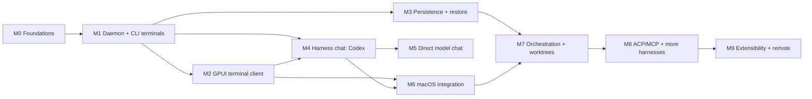

# Roadmap

Milestones M0–M6 form the **first vertical slice** (spec "Initial Implementation Scope"). M7+ expand toward the target scope in `vision.md`. Slice IDs are stable; tick boxes as slices land. Process: `process.md`.

## M0 — Foundations
Exit: workspace builds, gate green, protocol v0 types compile with roundtrip tests, ADR 0003–0005 accepted.
- [x] M0.1 Cargo workspace (`crates/*`, package `heeler-<dir>`), `rust-toolchain.toml` 1.98.0, `clippy.toml`, `deny.toml`, `justfile` (`just check` = fmt + clippy `-D warnings` + nextest + cargo-deny); pinned deps from ADR 0003/0004 in `[workspace.dependencies]`
- [x] M0.2 `core` IDs (ULID newtypes, `TerminalId`, `Seq`), `SessionState` machine; `protocol` frames + codec, control envelope, typed requests/results/events, render DTOs, error codes; golden fixtures `crates/protocol/tests/fixtures/v0/`
- [x] M0.3 Accept ADR 0003 GPUI sourcing, 0004 terminal engine, 0005 agent integration (spike evidence in `docs/spikes/`)
- [x] M0.4 Terminal conformance corpus in `crates/terminal/tests/corpus/`: 21 feature streams (whole, byte-by-byte, 7-byte chunks) + recordings (zsh, `seq`, vim) replayed to `.grid`. Open: htop (not installed), agent TUIs (omp, codex) need logins — record during M2 demo prep.

## M1 — Daemon + CLI terminals
Exit demo: `heeler new -- omp` in one terminal, `heeler attach <id>` from another, detach/reattach, two clients attached at once, `heeler ls --json`; heavy output keeps daemon memory bounded.

Execution (briefs in `docs/briefs/`, implementer agent per `process.md`): **M1-A** (M1.1 + M1.2, `daemon` + `client`) and **M1-B** (M1.3 + M0.4, `terminal`) in parallel → merged; **M1-C** (M1.6 part 1, `cli` + host renderer) after M1-A; **M1-D1** (M1.4 + M1.5, daemon sessions/attach) after M1-B, parallel with M1-C; **M1-D2** (orchestrator): CLI `new/ls/attach/send/stop`, M1.7 bench, demo.

- [x] M1.1 `heelerd` lifecycle: single-instance lock, socket perms, peer UID check, graceful shutdown, tracing to `~/Library/Logs/Heeler/`
- [x] M1.2 Connection layer: framing codec, handshake, per-client bounded queues, event ring with epoch/seq, replay
- [x] M1.3 `terminal`: PTY spawn, reader thread → OSC sniffer → engine, writer thread, resize, input, exit/reap, render tracker (merged `dd63216`; 180.7 MB/s, 26.2 MiB @10k lines)
- [x] M1.4 Terminal attach: snapshot queued before the response, credit-1 ack pacing (≤ 1 render / 8 ms), `terminal.history`, resize → snapshot, bounded input path (merged `6039594`)
- [x] M1.5 Session registry in memory: create/list/stop/restart/rename, metadata events (title/bell/notification/cwd), workspace close and shutdown rules (merged `6039594`)
- [x] M1.6 `heeler` CLI: `daemon start|stop|status`, `ws …`, `new`, `ls`, `attach` (raw mode, ctrl+\ d detach, SIGWINCH resize, restart follow), `send`, `stop/restart/rename`, `history`, `api`, `events` (merged `8a4a583`, `98a6c35`)
- [x] M1.7 Bench `cargo run --release -p heeler-daemon --example flood`: ≈193 MiB in 1.4 s (136 MiB/s end-to-end through daemon + acking client), non-acking client 0 renders after snapshot, `daemon.status` p99 0.11 ms, peak RSS 25.2 MiB

**M1 done (2026-10-13).** Demo checklist: `docs/demos/M1.md`.

## M2 — GPUI workbench and terminal client
Exit demo: run OMP and Codex TUI in the GPUI app with correct input/rendering; move panels between docks, split/move/zoom panes, switch presets (default / focus / overview); edit `settings.toml` and see it hot-reload (density, terminal font/theme, panel options); close app → sessions keep running → reopen restores layout and views; daemon restart → app reconnects; budgets in `vision.md` measured. Design: `docs/design.md`, ADR 0010.

Execution: wave 1 in parallel — **M2-A** (M2.2, `client`), **M2-B** (M2.1, `desktop` workbench core), **M2-C** (M2.3, `terminal_view`), **M2-D** (M2.4 engine, `settings`); wave 2 — **M2-E** (M2.5 panels + wiring + settings UI); wave 3 — **M2-F** (M2.6, orchestrator).

- [ ] M2.1 Workbench core: native chrome (transparent titlebar, vibrancy left dock), docks L/R/B hosting panel stacks, center split tree with per-pane tabs, drag & drop (tab → split edge / dock, panel → dock), resize, zoom, focus navigation, action registry + ⌘K palette skeleton, `PanelRegistry`/`StatusItemRegistry`, layout state persistence, presets
- [ ] M2.2 `client::Connection`: reconnect with backoff, replay/snapshot reconciliation into a state store, terminal handles that re-attach after reconnect, usable from GPUI's executor
- [ ] M2.3 `terminal_view`: grid rendering with shaped-row cache, cursor, selection/copy/paste, scrollback viewing, IME + non-Latin layouts, key (legacy + kitty) and mouse (SGR) encoding, resize from font metrics, theme colors reported to the daemon
- [ ] M2.4 Settings: layered TOML (defaults < user < workspace < runtime), typed namespaces with schemas, hot reload, keymap file, theme + density tokens
- [ ] M2.5 Panels and wiring: sessions sidebar (Needs you, workspaces, configurable rows), status bar items, overview board (live previews, attention sort), inspector (session info now; approvals/changes later), session create/stop/restart/rename, generated settings UI (⌘,), CLI and GUI concurrently on one session
- [ ] M2.6 Performance pass against budgets + M2 demo

## M3 — Persistence and restore
Exit demo: kill `heelerd`, start it → workspaces/sessions reappear, terminals respawn in cwd, Codex/OMP sessions resume via native resume IDs.
- [ ] M3.1 `storage` actor, migrations, schema for workspaces/sessions/layouts
- [ ] M3.2 Restore pipeline per ADR 0009 step 1
- [ ] M3.3 Agent resume references (integration env/hooks report session IDs)

## M4 — Harness chat (Codex)
Exit demo: open a Codex chat session, stream reply, see tool calls and diffs, approve a command from the UI, approval enforced in daemon; same conversation visible from CLI.
- [ ] M4.1 `agents::codex` adapter over `codex app-server` stdio JSON-RPC (pin supported Codex range; schema fixtures generated from the installed binary)
- [ ] M4.2 Unified `AgentEvent` model in `core` + protocol events (`chat.delta`, `agent.tool_call`, `approval.required`, …)
- [ ] M4.3 Approval engine in daemon (policy + pending decisions + audit rows)
- [ ] M4.4 Chat view in GPUI: messages, streaming, tool call cards, diff view, approval UI
- [ ] M4.5 Conversation persistence

## M5 — Direct model chat
Exit demo: chat with an OpenAI-compatible endpoint and a local Ollama model; switch model mid-conversation; keys in Keychain.
- [ ] M5.1 `gateway` provider trait + OpenAI-compatible + Anthropic adapters, streaming
- [ ] M5.2 Local endpoints (Ollama/LM Studio) discovery
- [ ] M5.3 Keychain credential store + `provider.*` protocol
- [ ] M5.4 Direct chat view reuses chat components

## M6 — macOS integration
Exit demo: with the window closed, an agent finishing triggers a native notification; an approval notification's "Approve" action unblocks the agent; launch-at-login agent mode works.
- [ ] M6.1 Spike: notifications from daemon vs helper (ADR 0007 open questions) → accept ADR 0007
- [ ] M6.2 App bundle build (`just bundle`), ad-hoc signing for dev
- [ ] M6.3 Notification intents + Notifier helper + action routing
- [ ] M6.4 SMAppService launch agent toggle; menu bar status; Dock badge; global shortcuts

**First vertical slice complete after M6** — run the full acceptance list from the spec.

## M7 — Orchestration
- Task placement: main checkout or worktree (create/list/remove), with a same-checkout conflict warning; multi-repo workspaces, task list with dependencies, parallel agents, attention rollups, diff review and merge, agent state detection for TUI agents (integration hooks first, screen manifests fallback).

## M8 — ACP, MCP, more harnesses
- ACP client adapter (Claude Code, OpenCode, Gemini, OMP), `session/load` resume, MCP server config pass-through; Heeler as MCP server exposing its own control surface to agents.

## M9 — Extensibility and remote
- Plugin manifests + event hooks; live daemon upgrade handoff (ADR 0009 step 2); remote transport (TLS over Tailscale/SSH) and mobile/web client feasibility.

## Risk register

| ID | Risk | Likelihood | Impact | Mitigation | Owner milestone |
|---|---|---|---|---|---|
| R1 | GPUI API churn (git-only, unpublishable on crates.io) | High | Medium | Pin rev; isolate GPUI to `desktop`; scheduled bump slices | M0/M2 |
| R2 | Terminal correctness gaps break TUIs (OMP, Codex) | Medium | High | Mature engine (ADR 0004), recorded-transcript corpus, real-TUI demos | M1/M2 |
| R3 | Agent protocols change (Codex app-server, ACP) | High | Medium | Adapters behind `AgentEvent`; schema generated from installed binary; fixture tests | M4/M8 |
| R4 | macOS bundling/signing blocks notifications/Keychain | Medium | Medium | Early M6.1 spike; dev ad-hoc signing | M6 |
| R5 | Unbounded memory under output floods | Medium | High | Bounded scrollback, per-client queue limits, resync protocol, bench in gate | M1/M2 |
| R6 | Scope creep toward full IDE | Medium | High | Non-goals in `vision.md`; scope changes need ADR | all |
| R7 | Provider ToS issues with subscriptions | Low | High | ADR 0008: subscriptions only through vendor harnesses | M4/M5 |
